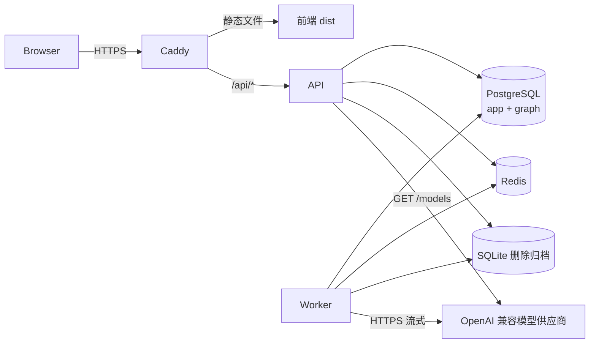

# 内部 AI 平台：项目框架

本文说明平台当前已实现部分的代码结构、运行方式和关键机制，供参与开发的工程师查阅。目标架构和路线图见[重构设计](../docs/design/ai-platform-refactor.md)；安装、运行命令见 [README](README.md)；部署见[部署手册](infra/deploy.md)。

## 1. 总览

平台由四个进程组成：

| 进程 | 作用 | 入口 |
| --- | --- | --- |
| Web | Caddy 提供前端静态文件，终止 TLS，把 `/api/*` 反向代理到 API | [infra/web.Dockerfile](infra/web.Dockerfile)、[infra/Caddyfile](infra/Caddyfile) |
| API | FastAPI 应用，处理所有 HTTP 请求 | `ai_platform.api.main:app` |
| Worker | 轮询任务表，执行模型连接测试和对话生成，并做定时清理 | `python -m ai_platform.worker` |
| Ops | 一次性运维命令（初始化管理员、建 checkpoint 表、重放删除归档等） | `ai-platform <command>`（[cli.py](backend/src/ai_platform/cli.py)） |

API、Worker 和 Ops 使用同一个 Python 包和同一个镜像。外部依赖只有三个：

- **PostgreSQL**：业务数据（`app` schema）和 LangGraph checkpoint（`graph` schema）放在同一个库。
- **Redis**：登录限流和模型调用准入计数。Redis 中的计数可以从 PostgreSQL 重建，不保存权威数据。
- **SQLite 删除归档**：放在独立持久卷上，用于数据库从备份恢复后重放已确认的删除。



API 不直接调用模型生成内容。API 只把任务写入 `app.execution_jobs`，由 Worker 领取并执行；浏览器通过 SSE 读取 Worker 写入的 `app.run_events`。唯一例外是"发现模型"接口，它由 API 同步请求供应商的 `GET /models`。

## 2. 技术栈

| 部分 | 选型 |
| --- | --- |
| 后端 | Python 3.12、FastAPI、Pydantic v2、psycopg 3（直接写 SQL，不用 ORM）、LangGraph（对话图与 checkpoint）、httpx、redis-py、argon2、cryptography（AES-GCM）、pyotp |
| 前端 | React 19、TypeScript、Vite、Ant Design 6、TanStack Query、React Router 7 |
| 接口契约 | 后端导出 OpenAPI，前端用 openapi-typescript 生成类型 |
| 测试 | pytest（后端）、Vitest（前端单元）、Playwright（端到端） |
| 部署 | Docker Compose、Caddy |

## 3. 目录结构

```
platform/
├── backend/                 Python 包 ai-platform（uv 管理）
│   ├── src/ai_platform/     源码，分层见第 4 节
│   └── tests/
│       ├── unit/            不依赖外部服务
│       ├── contract/        校验 contracts/openapi.json 与运行时一致
│       ├── integration/     需要 TEST_DATABASE_URL（可选 TEST_REDIS_URL）
│       └── provider/        需要真实供应商凭据，默认跳过
├── frontend/                React 单页应用
│   ├── src/
│   ├── tests/               Vitest
│   └── e2e/                 Playwright
├── contracts/openapi.json   前后端接口契约（由后端导出，提交到仓库）
└── infra/
    ├── sql/init.sql         全量建表脚本
    ├── sql/upgrades/        增量升级脚本（当前版本 0008_agent_releases）
    ├── compose.yaml         生产编排（api / worker / web / ops）
    ├── backend.Dockerfile、web.Dockerfile、Caddyfile
    └── database-setup.md、deploy.md
```

## 4. 后端

### 4.1 分层

后端采用经典分层，依赖方向固定为 **router → service → repository**：

```
src/ai_platform/
├── api/                     控制层
│   ├── main.py              创建 FastAPI 应用，注册路由和健康检查
│   ├── errors.py            请求 ID 中间件，异常到统一错误响应的映射
│   ├── deps.py              会话 Cookie、CSRF 校验，authenticated / anonymous / enrollment 事务上下文
│   └── routers/
│       ├── identity.py      /auth/*、/admin/users
│       ├── models.py        /admin/model-connections、/admin/models、/models、/usage、配额
│       └── chat.py          /agents、/conversations、/runs（含 SSE）、会话删除
├── services/                业务层
│   ├── identity.py          登录、会话、MFA、成员生命周期
│   ├── models.py            模型连接与模型定义、连接测试受理、配额、用量查询
│   ├── metering.py          月度配额、预留与结算、准入
│   ├── chat.py              智能体、发布、会话、对话受理、取消、事件读取
│   ├── chat_context.py      上下文窗口裁剪、历史摘要、历史缓存
│   ├── chat_execution.py    Worker：领取对话任务、流式生成、写入消息
│   ├── chat_graph.py        LangGraph 图与带围栏的 checkpoint saver
│   ├── connection_tests.py  Worker：执行模型连接测试
│   ├── dispatch.py          两类任务共用的派发步骤（事件、租约检查、预留调用）
│   ├── deletion.py          会话删除与 SQLite 归档
│   ├── common.py、pagination.py、clock.py
│   └── errors.py            业务异常（NotFound、Conflict 等）
├── repositories/            数据访问层，全部业务 SQL
│   ├── identity.py          users、auth_sessions、verification_tokens、mfa_recovery_codes
│   ├── models.py            model_connections、model_definitions、credential_secrets、测试请求与结果
│   ├── metering.py          quota_*、usage_records
│   ├── runs.py              runs、run_events、execution_jobs、model_calls、attempts、idempotency_records
│   ├── agents.py            agents、agent_versions、agent_releases、model_config_versions
│   ├── conversations.py     conversations、messages、上下文摘要、删除标记
│   ├── checkpoints.py       graph.write_receipts 等
│   └── common.py            工作区、审计、键集分页
├── schemas/                 Pydantic 请求与响应模型（identity / models / chat）
├── clients/
│   ├── provider.py          供应商 HTTP 调用（流式补全、模型列表、端点校验）
│   └── redis_limits.py      Redis Lua 脚本：登录限流、调用准入
├── db.py                    数据库连接（每个请求一个事务）
├── security.py              哈希、令牌、密码、AES-GCM 加解密
├── settings.py              配置（读取 .env 和环境变量）
├── worker.py                Worker 主循环
└── cli.py                   运维命令
```

各层约定：

- **router** 只做参数解析、鉴权、打开事务，然后调用 service。router 中不写 SQL。
- **service** 承担业务规则和流程编排，不依赖 FastAPI。出错时抛 [services/errors.py](backend/src/ai_platform/services/errors.py) 中的业务异常，由 [api/errors.py](backend/src/ai_platform/api/errors.py) 转换为 HTTP 状态码。
- **repository** 每个函数对应一到几条 SQL，接收 `conn` 参数，不开事务、不做业务判断。
- **事务边界**由 router 决定。`with authenticated(request) as (conn, session, user)` 打开一个事务，并在其中完成会话校验、CSRF 校验和会话续期；块结束时提交，抛出异常时回滚。需要在提交后执行的动作（例如写删除归档、调用供应商）放在 `with` 块之后。

### 4.2 一次请求的处理过程

以 `POST /api/v1/agents/{id}/runs`（发送对话消息）为例：

1. Caddy 限制请求体不超过 64 KB 并转发给 API。`ChatRoute` 在解析之前再校验一次大小。
2. `errors.py` 中间件生成 `X-Request-ID`，`/api/v1/*` 的响应统一加 `Cache-Control: no-store`。
3. 路由函数进入 `authenticated(request)`：从 Cookie 读取会话并 `FOR UPDATE` 加锁，校验会话阶段和 CSRF，刷新空闲过期时间。
4. `services.chat.accept_chat` 检查幂等键、智能体发布状态和会话是否已有进行中的运行，然后写入 `runs`、两条 `messages`（用户输入和空的助手回复）、`execution_jobs`、`idempotency_records` 以及第一条 `run.queued` 事件。
5. 事务提交，返回 202 和运行信息。
6. 前端调用 `GET /runs/{id}/events` 读取 SSE。Worker 写入的增量文本以 `message.delta` 事件推送。

错误响应的格式统一为：

```json
{"error": {"code": "CONFLICT", "message": "...", "request_id": "...", "retryable": false}}
```

### 4.3 Worker

[worker.py](backend/src/ai_platform/worker.py) 启动 4 个轮询协程和 1 个维护协程：

- **轮询**：每轮依次调用 `connection_tests.run_once` 和 `chat_execution.run_once`；两者都没有领到任务时休眠 1 秒。
- **维护**（每 60 秒）：清理过期会话、过期历史缓存、7 天前的运行事件和过期的可恢复结果，并重试待确认的删除归档。

一个对话任务的执行步骤：

1. `claim`：用 `FOR UPDATE SKIP LOCKED` 领取任务，`fencing_token` 加 1，获得 30 秒租约。
2. `execute_graph`：用 LangGraph 恢复会话线程的 checkpoint，追加本轮输入。图中的模型节点 `ControlledModel` 调用 `reply`。
3. `reply`：用 `Context` 计算上下文窗口。历史过长时先调用一次模型生成摘要（`context_summary`），再调用模型生成回复（`chat`）。
4. `invoke`：在一个事务里锁定并校验执行者、会话、智能体和模型仍然可用，解密 API Key，通过准入检查并预留配额，然后在事务外流式调用供应商。文本由 `WriteBuffer` 批量写入消息和事件，期间每 10 秒续一次租约。
5. 结束时按实际 usage 结算配额，写入终态事件（`run.completed`、`run.failed`、`run.cancelled` 或 `run.interrupted`）。

### 4.4 关键机制

**身份与会话**
- 会话令牌只存哈希。Cookie 设置为 HttpOnly、SameSite=Lax，生产环境强制 Secure。
- 会话分三个阶段：`anonymous`（只用于获取 CSRF）、`preauth`（管理员改初始密码或做 MFA）和 `full`。
- 所有非 GET 请求都校验 `Origin` 和 `X-CSRF-Token`。
- 管理员必须绑定 TOTP。高风险操作要求 5 分钟内重新验证（`/auth/reauthenticate`）。
- 登录、改密等尝试按用户名和 IP 两个维度在 Redis 中限流。

**凭据与供应商访问**
- 供应商 API Key 用 AES-GCM 加密存储，AAD 绑定连接 ID 和端点，换端点后旧密文无法解密。
- 每次请求前解析并固定目标 IP，禁止私网、链路本地和组播地址（`PRIVATE_MODEL_ALLOWLIST` 中显式列出的地址除外），禁止重定向，并保留原主机名做 TLS 校验。

**任务可靠性**
- *幂等*：受理对话和连接测试的接口要求 `Idempotency-Key` 请求头，记录保留 24 小时。用同一个键提交不同内容返回 `IDEMPOTENCY_CONFLICT`。
- *租约与围栏*：Worker 的每次写入都先通过 `locked_job` 校验自己的租约和 `fencing_token`。租约过期后被其他 Worker 接管时，旧 Worker 的写入会被拒绝。
- *不重复计费*：每次模型调用都会记录 `model_calls` 和 `model_call_attempts`。如果 Worker 在调用中途崩溃，接管者会等到原调用的截止时间过后，再把该调用标记为 `RESULT_UNKNOWN`。已完成调用的结果保存在 `recoverable_result` 中，重试时直接复用，不会再次调用供应商。
- *checkpoint 围栏*：`FencedSaver` 写入 checkpoint 前同样校验租约，并写一条 `graph.write_receipts` 作为写入成功的确认。

**计量与配额**
- 配额按工作区和自然月（Asia/Shanghai 时区）划分，有 `soft` 和 `strict` 两种模式。
- 派发调用前按估算的 token 数预留配额，调用结束后按供应商返回的 usage 结算。供应商没有返回 usage 时，预留状态记为 `uncertain`，之后由运维通过 `ai-platform reconcile-attempt` 人工对账。
- 准入限制：每个工作区每分钟最多 20 次调用、同时最多 2 个进行中的调用，全局同时最多 4 个。这些计数从 PostgreSQL 统计后写入 Redis。

**事件流**
- `run_events` 按运行递增编号。SSE 的事件 ID 格式为 `{run_id}:{sequence}`，断线后用 `Last-Event-ID` 或 `?after=` 从断点续读。
- 事件保留 7 天。请求的断点已被清理时返回 410 `EVENT_REPLAY_EXPIRED`，前端结束订阅并重新加载消息历史。

**会话删除**
- 删除会话时先把会话标记为 `deleting` 并写入删除标记，再把记录写入独立的 SQLite 归档。归档写入成功后，才清理正文、事件和 checkpoint。
- 数据库从备份恢复后，运行 `ai-platform replay-deletions`，重新执行归档中记录的删除。

### 4.5 数据库

所有表定义在 [infra/sql/init.sql](infra/sql/init.sql)，按用途分组：

| 分组 | 表 |
| --- | --- |
| 身份 | `users`、`workspaces`、`auth_sessions`、`verification_tokens`、`mfa_recovery_codes`、`audit_events` |
| 模型 | `credential_secrets`、`model_connections`、`model_definitions`、`model_config_versions`、`model_test_requests`、`model_connection_test_results` |
| 智能体 | `agents`、`agent_versions`、`agent_releases` |
| 对话 | `conversations`、`messages`、`conversation_context_summaries`、`conversation_deletion_markers` |
| 执行 | `runs`、`run_events`、`execution_jobs`、`idempotency_records`、`model_calls`、`model_call_attempts` |
| 计量 | `usage_records`、`quota_policies`、`quota_buckets`、`quota_reservations`、`quota_ledger` |
| 图（`graph` schema） | LangGraph 的 `checkpoints`、`checkpoint_blobs`、`checkpoint_writes`，以及 `write_receipts` |

修改表结构时，同时更新 `init.sql`，并在 `sql/upgrades/` 中新增一个升级脚本。升级脚本先检查 `public.alembic_version` 是否为上一个版本，执行完成后再写入新版本号。

## 5. 前端

### 5.1 结构

```
frontend/src/
├── main.tsx           应用入口：QueryClient、路由、外壳布局（顶栏导航、用户菜单）
├── api/
│   ├── client.ts      api() 请求封装：自动附加 CSRF，把错误转换为 ApiError
│   ├── health.ts
│   └── generated/     由 contracts/openapi.json 生成的类型，不要手改
├── ui.tsx             通用组件和工具：PageHeader、PageBody、ErrorAlert、分页、all() 拉取全部分页
├── identity.tsx       登录、首次改密、MFA 绑定与验证、账号安全、成员管理
├── models.tsx         模型配置（连接、模型、发现与导入、连接测试）、模型目录、配额、用量
├── workbench.tsx      智能体列表与编辑、发布、对话页（会话列表、消息流、SSE 订阅）
├── preview/           只在前端运行的原型页面：能力组件、应用接入、工作流、智能体能力绑定
└── styles.css
```

### 5.2 约定

- **服务端状态**统一用 TanStack Query 管理。登录或退出时清空除 `identity` 以外的所有缓存，避免显示上一个账号的数据。
- **请求**统一通过 `api<T>(path, method, body)` 发出，路径不带 `/api/v1` 前缀。非 GET 请求会先调用 `/auth/csrf` 获取令牌。
- **类型**来自 `Contract["SchemaName"]`。后端接口变化后，按顺序执行：在后端运行 `ai-platform export-openapi`，在前端运行 `npm run api:generate`，最后运行 `npm run typecheck`。
- **路由与权限**：`Workspace` 组件先请求 `/auth/me`，返回 401 时显示登录页。`/admin/*` 路由在前端检查管理员角色，真正的权限校验仍由后端完成。
- **对话流**：`subscribe()` 用 `fetch` 读取 SSE 流并手动解析帧，丢弃编号不大于当前游标的事件；`applyMessageEvent()` 把 `message.delta` 和 `message.snapshot` 合并到消息列表。
- **预览页面**：`preview/` 下的页面数据是写死在前端的示例，状态保存在 `PreviewProvider` 中，刷新页面后丢失，也不调用后端。它们用于展示规划中的知识库、数据源、MCP、Skill 和应用接入功能。

### 5.3 页面

| 路由 | 页面 | 权限 |
| --- | --- | --- |
| `/` | 落地页（显示 API 健康状态） | 公开 |
| `/agents`、`/agents/new`、`/agents/:id` | 智能体列表、新建、编辑与发布 | 成员 |
| `/chat`、`/chat/:id` | 对话 | 成员 |
| `/models` | 可用模型目录 | 成员 |
| `/usage` | 本月用量与调用明细 | 成员 |
| `/settings/security` | 改密、MFA、退出其他会话 | 成员 |
| `/admin/models`、`/admin/models/:id` | 模型连接与模型配置 | 管理员 |
| `/admin/users` | 成员与配额管理 | 管理员 |
| `/components/*`、`/integrations`、`/agents/:id/preview/:section` | 预览原型 | 成员 |

开发时 Vite 运行在 `127.0.0.1:5174`，把 `/api` 代理到 `127.0.0.1:8081`。生产环境由 Caddy 提供 `dist/` 静态文件，未命中的路径回退到 `index.html`。

## 6. 测试

| 层级 | 位置 | 依赖 | 命令 |
| --- | --- | --- | --- |
| 后端单元 | `backend/tests/unit` | 无 | `uv run pytest tests/unit` |
| 契约 | `backend/tests/contract` | 无 | `uv run pytest tests/contract` |
| 后端集成 | `backend/tests/integration` | `TEST_DATABASE_URL`，可选 `TEST_REDIS_URL` | `uv run pytest -rs tests/integration` |
| 真实供应商 | `backend/tests/provider` | `RUN_PROVIDER_TESTS=1` 及凭据 | 见 README |
| 前端单元 | `frontend/tests` | 无 | `npm run test -- --run` |
| 端到端 | `frontend/e2e` | 由 Playwright 自动启动 API 和 Vite | `npm run test:e2e` |

集成测试使用本机随机端口上的假供应商，并通过子进程模拟 Worker 崩溃和接管。缺少 `TEST_DATABASE_URL` 时，pytest 报告跳过而不是失败，验收时要确认集成测试确实执行了。

## 7. 新增一个后端功能的步骤

1. 在 `schemas/<领域>.py` 中定义请求和响应模型。
2. 在 `repositories/<表所属领域>.py` 中添加 SQL 函数。
3. 在 `services/<领域>.py` 中实现业务逻辑，出错时抛业务异常。
4. 在 `api/routers/<领域>.py` 中添加路由，用 `authenticated(...)` 打开事务并调用 service。
5. 需要改表时，同时更新 `infra/sql/init.sql` 并新增升级脚本。
6. 导出 OpenAPI 到 `contracts/openapi.json`，在前端重新生成类型，然后补充测试。
