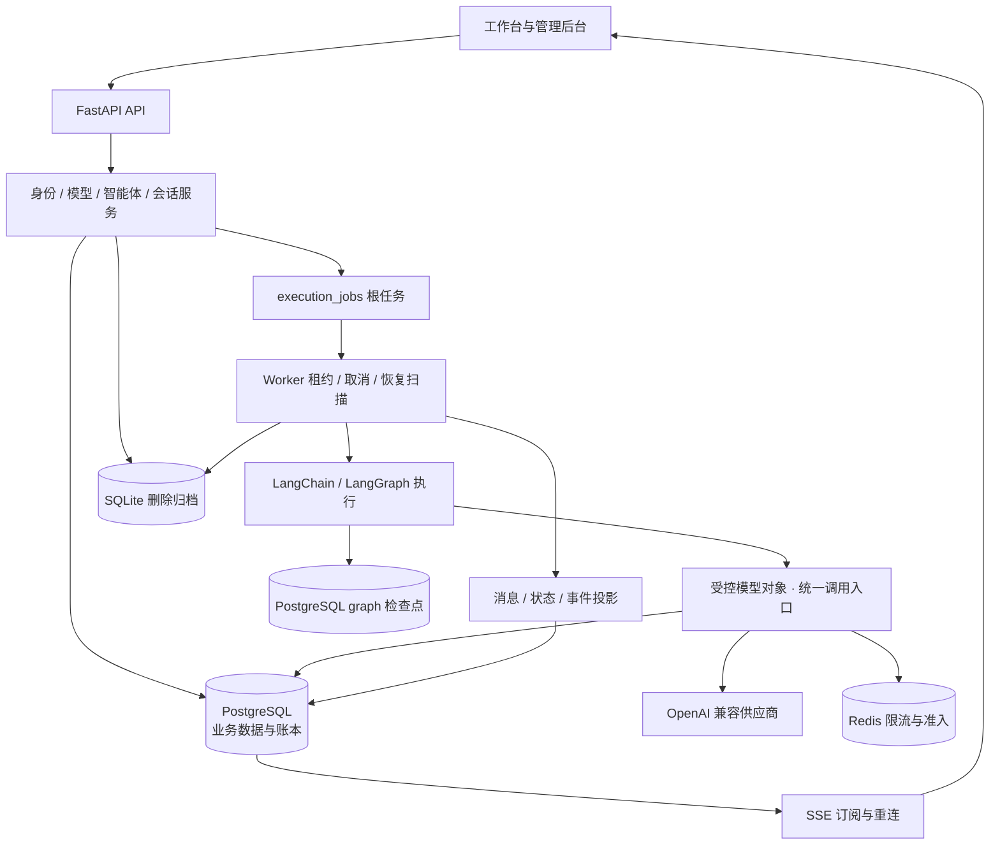

# 内部 AI 平台设计文档

本文是平台的总体设计：定位、架构、关键机制、数据模型和演进路线。内容以当前仓库代码为基准，未实现的部分明确标注为规划。

代码结构和分层见[项目框架](ARCHITECTURE.md)。安装与运行命令见 [README](../README.md)，部署步骤见[部署手册](../infra/deploy.md)，接口字段以 [contracts/openapi.json](../contracts/openapi.json) 为准（44 个路径、69 个 schema），表结构以 [infra/sql/init.sql](../infra/sql/init.sql) 为准。

## 1. 定位与边界

平台面向**单一可信内部团队**，把原有官网智能客服扩展为可独立部署的 AI 应用平台。平台管理员开通成员账号、配置多家供应商的模型连接和 Key；成员从可用目录中选择模型、配置智能体、发起多轮对话，刷新或重启后仍可查看历史、运行状态和用量。

已确认的产品需求：

1. 默认关闭公开注册，账号由管理员开通。工作台部署在受控网络。
2. 只有平台管理员能添加、测试和管理模型连接与上游 Key。成员只能引用模型 ID。
3. 成员能在前端配置智能体（模型、提示词、上下文与执行限制），并直接多轮对话和调试。
4. 对话持久化、账号管理、调用记录、Token 监控、使用限制和审计日志由后端统一提供。
5. 后续成员可创建应用并管理对外访问 Key，把 AI 能力接入官网客服、ERP 智能问数等业务系统。
6. 外部系统通过应用 API 产生的对话必须在后端持久化，并可在有权限的工作台与管理后台查看消息正文、图片和执行记录——调用次数或普通日志不能替代对话历史。

明确**不在**建设范围内：公开注册、商业 SaaS 运营与支付清算、任意用户代码或插件执行、跨工作区应用市场。自定义域名、多区域和 Kubernetes 不作为早期部署前置条件。

内部团队定位不等于默认共享私人对话和模型凭据。基础设施管理员属于可信运维边界，可接触主机和备份；应用层仍按最小权限保护成员的会话、凭据和业务数据，并记录管理访问。

## 2. 架构总览

平台由四个进程组成，API、Worker 和 Ops 共用同一个 Python 包和同一个镜像。

| 进程 | 作用 | 入口 |
| --- | --- | --- |
| Web | Caddy 提供前端静态文件，终止 TLS，把 `/api/*` 反代到 API | [infra/Caddyfile](../infra/Caddyfile) |
| API | FastAPI 应用，处理所有 HTTP 请求 | `ai_platform.api.main:app` |
| Worker | 轮询任务表，执行连接测试和对话生成，并做定时清理 | `python -m ai_platform.worker` |
| Ops | 一次性运维命令 | `ai-platform <command>` |

外部依赖只有三项：

- **PostgreSQL**：业务数据（`app` schema）和 LangGraph 检查点（`graph` schema）放在同一个库。
- **Redis**：登录限流和模型调用准入计数。Redis 中的计数可从 PostgreSQL 重建，不保存权威数据。
- **SQLite 删除归档**：位于独立持久卷，用于数据库从备份恢复后重放已确认的删除。

**API 不直接调用模型生成内容。** API 只把任务写入 `app.execution_jobs`，由 Worker 领取执行；浏览器通过 SSE 读取 Worker 写入的 `app.run_events`。唯一例外是"发现模型"接口，它由 API 同步请求供应商的 `GET /models`。

API 实例不持有唯一业务会话状态，可横向扩容；同会话执行互斥和额度准入跨实例生效。数据库不可用时不接受无法持久化的新调用。

### 2.1 核心设计决策

| 编号 | 决策 | 理由与边界 |
| --- | --- | --- |
| D01 | 模块化单体，一个后端代码库，API 与 Worker 分进程运行 | 先保证业务一致性，按负载拆进程，不提前拆微服务 |
| D02 | 分层固定为 router → service → repository，直接写 SQL | SQL 可审查、事务边界明确；不引入 ORM 抽象层 |
| D03 | FastAPI + Pydantic v2，后端导出 OpenAPI 为唯一契约来源 | 前端类型由契约生成，避免手写两套请求模型 |
| D04 | LangChain `create_agent` + LangGraph 检查点 | LangChain 负责模型循环，LangGraph 负责状态与恢复；不自写 ReAct 循环 |
| D05 | 业务消息与图检查点分开存储 | 历史查询与导出不依赖框架内部状态格式 |
| D06 | Redis 纳入部署基线，但不作为权威数据源 | 只存共享限流和短期协调状态，可从 PostgreSQL 重建 |
| D07 | 智能体执行快照不可变，会话绑定创建时的版本 | 草稿编辑不影响已有会话和在途执行 |
| D08 | 上游凭据由平台集中管理，用量按工作区归属 | 区分平台供应商结算与成员使用额度 |
| D09 | 模型调用仅由受控模型对象执行，统一入口独占重试 | SDK、Worker 和图节点不能各自隐藏重试并漏记消耗 |
| D10 | 用 PostgreSQL 任务记录直接领取，不引入外部队列 | 根 Run 与任务同事务创建；接外部队列时才启用 outbox 投递 |
| D11 | 不开放任意代码和任意插件执行 | 共享服务中只执行经过平台审核的工具 |

依赖全部精确锁定（后端 `==`，前端无 `^`），生产与 CI 用锁文件安装，不在启动时升级包。后端依赖中的 `sqlalchemy` 当前未被任何源码引用，仅作为 Alembic 的传递依赖保留。

### 2.2 技术栈

| 部分 | 选型 |
| --- | --- |
| 后端 | Python 3.12、FastAPI 0.162、Pydantic 2.14、psycopg 3.3（直接写 SQL）、LangChain 1.4 / LangGraph 1.2、httpx、redis-py、argon2、cryptography（AES-GCM）、pyotp |
| 存储 | PostgreSQL 17（业务数据 `app` schema + LangGraph 检查点 `graph` schema，同库）、Redis 7.4+（限流与准入计数）、SQLite（独立持久卷上的删除归档） |
| 前端 | React 19.2、TypeScript 5.9、Vite 8、Ant Design 6.6、TanStack Query 5、React Router 7 |
| 接口契约 | 后端 `ai-platform export-openapi` 导出，前端 `openapi-typescript` 生成类型 |
| 测试 | pytest、Vitest、Playwright |
| 部署 | Docker Compose、Caddy |

PostgreSQL 与 Redis 是独立实例，由托管服务或运维提供，不在应用 Compose 内。开发基线为 PostgreSQL 17.12 和 Redis 8.2；Redis 只做限流与短期协调，计数可从 PostgreSQL 重建，对小版本不敏感。

## 3. 身份、工作区与权限

### 3.1 身份模型

当前已实现账号、个人工作区和成员/管理员两种角色。团队协作相关的身份对象属于规划：

- **平台账号 User**（已实现）：管理员开通的内部成员登录主体，可拥有工作区。状态为 `pending`/`active`/`disabled`/`deleted`。
- **工作区 Workspace**（已实现 personal）：应用、连接、数据和用量的归属边界。成员自动获得个人工作区，管理员也使用个人工作区聊天。
- **平台管理员**（已实现）：管理账号状态、模型连接和平台策略。可替换上游 Key，查询接口不回显明文。
- **成员 Membership、团队工作区**（规划）：团队工作区由管理员指定 owner、maintainer、reader。
- **集成身份 Integration、应用执行身份、外部终端用户**（规划）：见第 8 节。

角色授权与资源归属同时检查。服务端根据登录态解析工作区，**不信任请求体自行声明的 `workspace_id`、计费主体或工具权限**。

| 操作 | 成员 | 平台管理员 |
| --- | --- | --- |
| 配置自己的智能体、发起对话 | 自己工作区内允许 | 同成员 |
| 查看可用模型目录 | 只读，不回显 Key | 允许 |
| 管理模型连接与上游 Key、开通/禁用成员、设置额度 | 不允许（403） | 允许并审计 |
| 获取已保存 Key 的明文 | 不允许 | 不允许 |
| 查询他人私人对话正文 | 不允许 | 无此接口 |

### 3.2 账号生命周期

- 首次部署用 `ai-platform bootstrap-admin` 创建唯一初始管理员及个人工作区，初始账号和密码均为 `admin`，只写入 Argon2id 散列并标记必须改密。已有管理员时拒绝重复初始化。
- 初始预置密码是长度规则的唯一例外。用户设置的新密码须为 12–128 字符。登录名统一小写，匹配 `[a-z0-9][a-z0-9._-]{2,63}`，创建后固定。管理员 UI 只创建普通成员。
- 新成员状态为 `pending`，管理员只看到一次激活 token，通过受控渠道交付；激活设置密码后转 `active`。重发使旧 token 失效。数据库仅保存 token 摘要。
- 成员删除后登录名释放（`users` 的唯一性改为 `WHERE status <> 'deleted'` 的部分唯一索引）。
- 禁用账号阻止新登录及新执行，并要求 Worker 在后续调用边界停止；已发生的 usage 仍结算。禁止禁用最后一位 active 管理员。
- 管理员失去 TOTP 和恢复码时，由有主机权限的运维执行 `ai-platform reset-admin-mfa --username <name>`；**不提供绕过 MFA 的公开接口**。

### 3.3 会话、MFA 与 CSRF

会话分三个阶段：`anonymous`（仅用于获取 CSRF）、`preauth`（管理员改初始密码或做 MFA）、`full`。

- 会话令牌只存 SHA-256 摘要，不返回 JWT 给浏览器存储。Cookie 为 `__Host-ai_session`（开发环境 `ai_session_dev`）：HttpOnly、SameSite=Lax、Path=/，不设 Domain。
- 生产的 `APP_ORIGIN` 必须是 HTTPS（非生产允许回环 HTTP），Cookie 的 Secure 属性由此派生。
- 所有非 GET 请求同时校验 `Origin` 和 `X-CSRF-Token`，并与服务端会话绑定。单独有 Cookie 或同名 Header 不算通过。登录后轮换 CSRF 上下文。
- 管理员必须绑定 TOTP：先完成改密，再绑定，此后每次登录都要验证。必改密和 MFA 阶段均禁止访问后台及模型管理接口。TOTP 采用 30 秒时间步、允许前后各一步，保存上次使用计数器拒绝重放。种子加密存储，设置后展示一次 10 个单次恢复码，只存摘要。
- 高风险操作要求 5 分钟内重新验证（`POST /auth/reauthenticate`）。
- 登录与改密按用户名和 IP 两个维度在 Redis 中限流。

会话寿命、令牌有效期等均为代码常量：匿名 30 分钟、preauth 5 分钟、完整会话绝对 7 天且空闲 12 小时、激活 token 1 天、重置 token 30 分钟。

## 4. 模型连接与凭据

### 4.1 模型资源

| 对象 | 内容 |
| --- | --- |
| Model Connection | 名称、API 根地址、凭据引用、协议、状态、连接版本 |
| Model Definition | 上游模型名、展示名、上下文/输出上限、是否支持温度、usage 支持情况、能力验证状态 |
| Model Config Version | 连接与模型定义的不可变配置快照，不含 Key |
| Model Grant（规划） | 允许使用该模型的工作区、使用入口和约束 |
| Pricing Version（规划） | 币种、输入/输出定价规则、生效时间与来源 |

当前协议固定为兼容 Chat Completions 的文本接口，`base_url` 为 API 根路径，适配器只追加固定聊天路径。支持 system/user/assistant 文本及 SSE，不自动切换到另一种 API，不发送工具、图片或供应商未知参数。**SDK 自动重试设为 0**，统一入口默认也不自动重试；用户明确重新发送才创建新 Run。

同一供应商允许多个连接，一条连接允许配置多个模型。连接的 `base_url` 与协议在创建后固定——更换端点须创建新连接和模型，原会话继续绑定原连接。Key 可在原连接内轮换。

管理员可通过 `GET /admin/model-connections/{id}/discover` 拉取供应商的模型列表并批量导入（1–500 个）。

### 4.2 模型目录资格

成员目录（`GET /models`）只返回连接和模型均已启用、且**当前模型请求配置代次与凭据版本通过过显式测试**的模型。规则：

- 连接测试记录模型、实际派发的请求配置代次和凭据版本。变更上游模型标识或影响请求的能力参数时，原子递增该代次——即使改回旧值也生成新代次。
- 连接测试受理时记录待测代次；派发前发现代次或凭据版本已变化，则结束该测试并要求重新发起。
- 对同一模型、请求配置代次和凭据版本，按受理顺序取最新已完成测试，避免迟到结果覆盖较新结果。匹配记录不存在时为 `untested`。
- 取消或未实际派发的测试不更新资格。测试失败保留凭据。
- 连接测试会产生真实费用，用量归发起管理员的工作区，使用固定短提示词和最多 32 输出 Token。

既有会话按固定配置续聊，派发时检查连接与模型的启用状态，并使用该连接的当前凭据。模型禁用即时阻止新派发。

### 4.3 凭据保护与出站策略

- 上游 Key 用 AES-256-GCM 加密存储，AAD 绑定凭据用途、连接 ID 和固定端点——换端点后旧密文无法解密。密钥从部署 secret 文件加载（`CREDENTIAL_KEY_FILE`，32 原始字节），版本化保存（`CREDENTIAL_KEY_VERSION`），不与业务库放在一起。
- Key 不写入提示词、图检查点、普通日志和前端持久化存储。查询接口只返回脱敏值和元信息。后端具备解密能力不等于运维可在管理页面查看明文。
- 每次请求前解析并固定目标 IP，禁止私网、链路本地、组播和云元数据地址，禁止重定向，并保留原主机名做 TLS 校验。拒绝 URL 内嵌用户名密码、fragment 和任意 query 认证。
- 内网模型服务须由运维在 `PRIVATE_MODEL_ALLOWLIST` 中逐条登记精确的 API 根地址（含方案、主机、端口、路径），成员不能自行扩大范围。生产禁止回环 HTTP。
- 测试和正式请求使用同一出站实现，代理不能绕过同一策略。

## 5. 智能体、会话与执行

### 5.1 智能体配置与发布

**智能体 Agent** 定义"如何回答"：模型、提示词、上下文策略和执行限制。当前可配置：名称、描述、系统提示词（≤16000 字符）、模型、温度、输出上限（1–4096，默认 1024）、上下文预算（默认 8192 Token）、压缩阈值（50–95，默认 80）、原始历史条数上限（2–100 的偶数，默认 20）。

草稿 → 发布为不可变版本 → 新会话绑定最近发布版本：

- 保存配置都携带 `revision`，原子比较后递增；冲突返回 409，不静默覆盖。
- 发布时在同一事务中锁定草稿、验证模型并固定配置快照。首次发布为 v1，此后有修改的草稿每次发布递增一版；重复发布同一修订返回同一版本。
- 创建会话要求 `agent_revision` 等于当前 `published_revision`，否则返回 409 要求刷新。首次发布前创建会话返回 409。
- 已有会话始终引用原 `agent_version_id`。修改配置只对新会话生效。
- 归档智能体拒绝新会话，既有会话保留查看但停止续聊。

**可见性**：私人智能体仅创建人和管理员可查看、编辑、发布和使用；公开智能体允许所有已登录成员编辑、发布和使用。只有创建人和管理员能更改可见性或归档。可见性在保存时立即生效，改为私人后其他成员仍可查看自己的历史但无法继续调用。会话历史始终归发起者的个人工作区。

会话标题默认取第一条文本前 30 个字符，可手动改名，不调用模型生成标题。

### 5.2 一次对话的执行流程

以 `POST /api/v1/agents/{id}/runs` 为例：

1. Caddy 限制请求体不超过 64 KiB 并转发给 API；`ChatRoute` 在解析前再校验一次大小。
2. 中间件生成 `X-Request-ID`，`/api/v1/*` 响应统一加 `Cache-Control: no-store`。
3. 路由进入 `authenticated(request)`：从 Cookie 读取会话并 `FOR UPDATE` 加锁，校验会话阶段和 CSRF，刷新空闲过期时间。
4. 服务层检查幂等键、智能体发布状态和会话是否已有进行中的 Run，然后在**同一事务**中写入 `runs`、两条 `messages`（用户输入和空的助手回复）、`execution_jobs`、`idempotency_records` 和第一条 `run.queued` 事件。
5. 事务提交，返回 202 和 Run 信息。提交后才确认接收并允许模型派发。
6. Worker 用 `FOR UPDATE SKIP LOCKED` 领取任务，递增 `fencing_token`，获得 30 秒租约。
7. 用 LangGraph 恢复会话线程的检查点，追加本轮输入；图中的模型节点调用受控模型对象。
8. 计算上下文窗口。历史过长时先调用一次模型生成摘要（`context_summary`），再调用模型生成回复（`chat`）。
9. 派发前在一个事务里锁定并校验执行者、会话、智能体和模型仍可用，解密 Key，通过准入检查并预留配额，然后**在事务外**流式调用供应商。
10. 文本由写缓冲批量写入消息和事件，期间每 10 秒续租。结束时按实际 usage 结算配额，写入终态事件。

错误响应统一为 `{"error": {"code", "message", "request_id", "retryable"}}`。状态码约定：401 未登录、403 已认证但不允许、404 不存在或不可见、409 revision/幂等/活动 Run 冲突、413 请求体超限、422 输入错误、429 准入拒绝、503 依赖不可用。流开始后的错误通过终态事件交付。

**幂等**：聊天作用域为 `(workspace_id, user_id, agent_id, Idempotency-Key)`，保留 24 小时。同 Key 同请求返回原 Run，同 Key 不同请求返回 409 `IDEMPOTENCY_CONFLICT`。活动会话遇到其他幂等键返回 409 `CONVERSATION_BUSY`。唯一约束必须能处理并发提交，不只靠先查询。

### 5.3 Run 生命周期与恢复

Run 状态为 `queued`、`running`、`cancel_requested`、`succeeded`、`failed`、`cancelled`、`interrupted`。主路径 queued → running → succeeded/failed；queued 可直接 cancelled，running 经 cancel_requested 进入 cancelled，失去执行权且结果不确定时进入 `interrupted`。四种终态提交后不可改回 running。结算状态独立于执行状态，Run 终止后仍可有待核对用量。

**租约与围栏**：Worker 的每次写入都先校验自己的租约和 `fencing_token`。租约过期被其他 Worker 接管后，旧 Worker 的写入会被拒绝。检查点写入同样经过围栏校验，并写一条 `graph.write_receipts` 作为写入成功的确认。所有图写入（含 pending writes）与执行权校验在同一个 PostgreSQL 事务中完成。

fencing 保护数据库写入，**不能撤回已发出的上游请求**，因此不承诺模型调用恰好执行一次。

**不重复计费**：每次模型调用记录 `model_calls` 和 `model_call_attempts`。Worker 在调用中途崩溃时，接管者等到原调用的截止时间过后才把该调用标记为 `RESULT_UNKNOWN`。已完成调用的结果保存在 `recoverable_result` 中，重试时直接复用，不再次调用供应商。

| 崩溃位置 | 恢复处理 |
| --- | --- |
| 输入与任务已保存，尚无执行检查点 | 重新领取任务，按原 message ID 注入一次输入 |
| 输入已进入检查点，业务索引滞后 | 从有效执行代次写入的图状态去重输入，补齐业务索引 |
| 图结果已保存，最终业务消息未提交 | 补写消息、终态与事件投影，不重复模型调用 |
| 业务消息已提交，订阅通知未发出 | SSE 从数据库游标重放，不重新生成结果 |
| 上游结果不确定 | 保留已保存片段，进入 interrupted / 待核对流程，不自动免费重试 |

浏览器断连不取消 Run，必须通过取消接口明确停止。取消 queued Run 可直接终止；running Run 进入 cancel_requested 并阻止后续派发。取消仍可能收到上游 usage，独立结算。

时限均为代码常量：未启动任务 5 分钟视为超时，对话执行 deadline 180 秒（摘要和回复共用），连接测试取 min(45 秒, 启动+90 秒)。Worker 接管或恢复时沿用原截止时间。

### 5.4 对话写入与流式

- 用户消息、Run 和执行任务在同一事务中写入，提交后才确认接收。
- AI 回复的**首个可见文字片段立即写入并推送**。后续片段在 Worker 进程内存合并，从该批首个待写入片段起满 1 秒或累计达 8 KiB 触发写入。SSE 增量和消息快照投影同事务提交，提交后才推送。正常完成、取消和可控失败时立即提交剩余片段、最终快照和终态。
- 批次写入失败时保留待提交数据，按同一批次的序号幂等重试。Worker 突然退出时，未提交且未推送的最后一批可能丢失；已推送片段可从数据库重放。
- 已提交的会话上下文可在 Worker 内保留以便续聊。连续空闲 30 分钟且无活动 Run 时，先确认待写入内容已保存，再释放缓存。有新请求时从数据库及有效检查点重新加载。

**SSE 契约**：`run_events` 按 Run 递增编号，事件 ID 为 `{run_id}:{sequence}`，断线后用 `Last-Event-ID` 或 `?after=` 续读，心跳 15 秒。事件先持久化再发送。事件保留 7 天；断点已被清理时返回 410 `EVENT_REPLAY_EXPIRED`，前端结束订阅并重新加载消息历史。

`message.started` 创建消息，`message.delta` 仅追加文本，`message.snapshot` 按消息 ID 替换完整内容及状态。取消、失败和 interrupted 同样保存部分消息快照。消息快照接口返回与快照处于同一数据库一致性视图的游标；客户端先应用快照，再订阅游标之后的事件，按 Run 和 sequence 去重。

**读取历史不触发任何模型调用。** 重连、快照读取和事件重放均不执行模型。显式重试是一项新的业务操作，生成新的 Run 并重新进行额度准入。

### 5.5 上下文长度与压缩

总预算取智能体 `context_budget_tokens`、模型 `context_limit_tokens` 和部署上限 `CONTEXT_LIMIT_TOKENS`（默认 32768）三者中的最小值。先从总预算扣除输出上限、系统提示词、当前用户输入和协议开销，再计算历史可用预算。提示词与当前输入完整保留。固定输入和输出预留已超出总预算时返回 `CONTEXT_LIMIT_EXCEEDED`。

1. 从已成功轮次构造候选上下文（上一版摘要 + 其后未覆盖的原始轮次）。历史达到可用预算的压缩阈值，或原始历史条数超过 `history_max_messages` 时触发压缩。优先处理较早的完整问答，尽可能保留最近两轮和当前输入。
2. 用上一版摘要和本次选中的较早轮次生成滚动摘要，保留已确认事实、用户约束、决定和待处理事项。每个聊天 Run 最多派发一次摘要调用，输出最多 512 Token。剩余执行时间少于 120 秒时跳过摘要并裁剪历史；摘要请求最多使用 60 秒。
3. 摘要以会话、生成 Run 和已覆盖的消息序号保存，只覆盖选中的历史前缀。**原始业务历史完整保留并可回看**——压缩只改变送给模型的内容。
4. 派发回复前同时校验 Token 预算和条数上限。跳过摘要、摘要输入放不进窗口、调用失败或压缩后仍超限时，优先保留最新完整轮次，移除放不下的旧轮次。客户端通过 `context_compression`（`none`/`summarized`/`truncated`）区分本轮处理方式。

摘要使用当前会话固定的模型，沿用根 Run 的权限、取消、时限与预算，用 `purpose=context_summary` **独立记录调用和用量**，与最终回复分别准入、预留和结算。

### 5.6 会话删除

删除会话与新 Run 创建对同一会话行加锁。确认无活动 Run 后，在同一事务内标记隐藏并写入待归档记录（仅含工作区 ID、会话 ID、删除时间和事件 ID），再把记录写入独立的 SQLite 归档。

- 归档以 FULL 同步提交，用 `mode=rw` 打开——归档文件缺失或被替换时返回 503，**不静默新建空库后确认删除**。
- 获得持久确认后才返回 202 `{"status": "deleting"}`。归档暂不可用时保留隐藏状态并后台重试，返回可重试的 503 `DELETION_ARCHIVE_PENDING`。活动 Run 中返回 409。
- 归档确认后清理消息、摘要、检查点、事件和可恢复结果；关联终态 Run 标记 `payload_purged_at`，保留最小计量元数据。purged 状态不能再进入执行或用于恢复。
- 数据库从备份恢复后运行 `ai-platform replay-deletions` 重放归档中的删除。若标记尚未归档即恢复到删除前的备份，会话可能重新出现，用户可重新发起删除。
- 归档存储必须覆盖部署恢复的故障域；包含整机恢复的部署应使用异机持久存储，且部署恢复流程不得用业务备份覆盖它。

## 6. 计量、额度与费用

### 6.1 三套概念不能混用

| 概念 | 定义 | 用途 |
| --- | --- | --- |
| 供应商 usage | 供应商报告的输入、输出、缓存等用量 | 保留原始值与标准化值 |
| 平台额度 | 平台允许的使用量 | 准入与限制；不是供应商余额 |
| 估算费用 | 用调用时价格版本计算的金额 | 监控和预算；不是已核验的供应商账单 |

当前**没有可靠的价格配置来源**，价格快照、估算金额和币种为空，费用界面显示未知，未定价尝试单独统计。缺失价格显示未知，不记为零成本。

### 6.2 预留与结算

配额按工作区和自然月划分（Asia/Shanghai 月界，存 UTC），有 `soft` 和 `strict` 两种模式。默认每月 1,000,000 Token，管理员可调，0 表示禁止新模型调用。

1. 先生成稳定 attempt ID，用于 Redis 准入、数据库预留和后续结算关联。Redis 原子申请共享速率/并发资格，PostgreSQL 按固定顺序锁定额度桶并预留。二者不构成分布式原子事务。
2. 预留必须覆盖本次实际构造的输入及受限输出。**不得持有额度数据库事务等待上游网络调用。**
3. 在发送前持久化派发意图。完成后根据 usage 在事务内结算，释放差额，追加不可变流水；结算唯一键固定为 `attempt_id:settle`，保证重复回调不重复扣额。
4. 能证明未发送的失败释放预留。已派发但 usage 未知的请求进入 `uncertain` 保守占用，**不直接按零消耗退款**——超时、缺失 usage、用户点取消均不是零消耗证据。
5. 对账时追加调整流水，不改写历史。运维通过有审计的 `ai-platform reconcile-attempt` 输入确认 usage 或供应商无消耗证据。

soft 模式也记录用量，并在确认消耗加现有占用达到月限时拒绝新准入；未知模型输入先按保守估算预留。strict 资格要求可验证的输入计数和输出上界；工作区切 strict 后，未具备资格的模型返回 `STRICT_BUDGET_UNSUPPORTED`，**不静默软化限制**。若上游报告用量超过验证上界，记录全部实际用量并暂停该连接的严格预算资格，不截断 usage 来伪造额度保证。

跨周期请求按准入时冻结的周期结算，不按返回时间切换额度桶。月度策略变更同时更新当期桶限额，不变更已结算消耗。

### 6.3 准入限制

硬编码在 Redis Lua 脚本中，不可配置：每工作区每分钟 < 20 次调用、工作区并发 < 2、全局并发 < 4。计数从 PostgreSQL 统计后写入 Redis，键 TTL 180 秒。Redis 重启丢失协调状态时，暂停新准入并从数据库在途记录重建并发占位。

同一逻辑模型调用可能有多个真实上游尝试，各自计费并重新准入。摘要调用与最终回复分别计量。并发令牌、任务执行租约与额度预留拥有独立生命周期——**不能仅因 Worker 心跳过期就同时释放所有预留**，并发占位按上游 deadline 保守保留。

### 6.4 其他保留期与限额

| 项目 | 值 |
| --- | --- |
| `run_events` / SSE 重放窗口 | 7 天（每批 100 条） |
| 幂等记录 | 24 小时 |
| 可恢复结果 | 投影完成后 24 小时，待核对最长 7 天 |
| 用量查询区间 | 最长 90 天 |
| 单条文本输入 | ≤8000 字符且 ≤32 KiB |
| HTTP JSON 请求体 | ≤64 KiB（仅 chat 路由强制） |
| 列表分页 | 默认 20，最大 100，按 `(created_at, id)` 稳定分页 |

## 7. 数据模型

业务 schema 为 `app`，LangGraph 检查点使用独立 `graph` schema，两者在同一个库。主键为 UUID，时间用 timestamptz；有状态资源含 created_at/updated_at，用户可修改配置含 `revision`（从 1 开始）。枚举用 text + CHECK，计数用 bigint，费用用 numeric(20,8) + currency，JSON 用 jsonb。**不以 JSON 存放可恢复的明文凭据。**

工作区内资源使用 `(workspace_id, id)` 唯一键与复合外键，业务代码不接受任意 workspace_id。模型连接、模型定义和快照、上游凭据属于平台；Run、消息和账本按发起者的工作区记录和隔离。

| 分组 | 表 |
| --- | --- |
| 身份 | `users`、`workspaces`、`auth_sessions`、`verification_tokens`、`mfa_recovery_codes`、`audit_events` |
| 模型 | `credential_secrets`、`model_connections`、`model_definitions`、`model_config_versions`、`model_test_requests`、`model_connection_test_results` |
| 智能体 | `agents`、`agent_versions`、`agent_releases` |
| 对话 | `conversations`、`messages`、`conversation_context_summaries`、`conversation_deletion_markers` |
| 执行 | `runs`、`run_events`、`execution_jobs`、`idempotency_records`、`model_calls`、`model_call_attempts` |
| 计量 | `usage_records`、`quota_policies`、`quota_buckets`、`quota_reservations`、`quota_ledger` |
| 图（`graph`） | `checkpoint_migrations`、`checkpoints`、`checkpoint_blobs`、`checkpoint_writes`、`write_receipts` |

### 7.1 标识与约束要点

- `auth_session_id` 是登录会话，`conversation_id` 是业务对话，`run_id` 是一次执行——三者不能互相替代。
- `thread_id` 由后端按会话生成，只在授权后用于访问图状态。外部调用者不能指定任意 thread。
- `run_events` 的 `(root_run_id, sequence)` 唯一；消息、工具结果和 usage 的持久化操作都有去重标识。
- `messages` 的 `unique(conversation_id, sequence)` 和 `unique(run_id, role)` 保证一次 Run 一条输入、一条回答。
- `execution_jobs` 的 `unique(run_id)`，根 Run 与任务同事务写入。
- `quota_ledger` 的 `unique(settlement_key)` 为追加流水，不覆盖历史；更正用新的 adjustment。
- messages 与 runs 的循环引用在建表时后建外键，事务内预分配 UUID 并使用可延迟约束——不为省事移除关系约束。
- 删除会话不级联删除 usage、账本和审计。
- API 层和存储层均应用归属检查。PostgreSQL RLS 可作为额外防线，但必须验证连接池上下文重置与数据库角色权限，不能仅增加一个 `workspace_id` 字段。

### 7.2 权威数据边界

| 数据 | 权威用途 | 不承担的用途 |
| --- | --- | --- |
| `messages` / `runs` | 业务历史和可见执行状态 | 不通过每轮全量追加历史重建图上下文 |
| LangGraph 检查点 | 模型上下文、节点与当前执行恢复状态 | 不作为后台查询协议 |
| `run_events` | 有限保留的过程事件、增量展示和重连重放 | 不作为永久唯一消息正文 |
| `usage_records` / `quota_ledger` | 真实调用归属、消耗与结算 | 不通过客户端事件统计扣额 |

业务库与图检查点分开提交，不承诺跨两者的自动原子性。图状态包含稳定消息 ID 及 `applied_input_seq`，正常续聊仅注入高于该位置的新输入。恢复时读取实际检查点确定哪些输入已应用；`runs` 表中记录的 checkpoint ID 只是可核对索引，不单独证明图状态已提交。

### 7.3 结构版本管理

当前结构版本为 `0008_agent_releases`，记录在 `public.alembic_version`。

[infra/sql/init.sql](../infra/sql/init.sql) 是全量建表脚本，内联了 0001–0008 的全部 DDL（0001 身份、0002 模型、0003 执行、0004 计量、0005 会话删除、0006 成员删除、0007 共享智能体、0008 发布版本与可见性）。[infra/sql/upgrades/](../infra/sql/upgrades/) 只存 0006 起的增量脚本——0001–0005 没有独立脚本。

每个升级脚本的模式一致：锁 `alembic_version` → 已是目标版本则返回 → 前置版本不符则抛异常 → 执行 DDL → 更新版本号，整体包在事务中。**修改表结构时同时更新 `init.sql` 并新增一个升级脚本。**

发布顺序为备份 → 业务迁移 → 检查点初始化 → API/Worker；迁移失败不启动新版本。回退优先应用版本回退，破坏性 schema downgrade 只在隔离测试库演练。

## 8. 规划能力

以下能力已确认需求、保留设计边界，但尚未实现。未实现的模块不注册业务路由，服务端拒绝不支持的输入与配置；前端不展示可操作的占位入口（`frontend/src/preview/` 下的原型页面明确标注为示例数据）。

### 8.1 图文对话

覆盖成员直接聊天、调试、工作台应用聊天和外部应用 API。支持 JPEG、PNG、WebP 静态图片的完整链路：网页选图/拖拽/粘贴、多图与纯图片消息、视觉模型调用、持久化及历史回看。

流程为：创建会话 → 上传二进制得到稳定 `file_id` → 后端校验实际类型、可解码性、尺寸、像素和大小并生成规范化图片及缩略图 → 状态 `ready` 后才允许绑定消息 → 提交 Run 时引用 `file_id`，后端再次校验会话归属、文件状态和模型能力 → Provider Adapter 把内容块转换为供应商接受的多模态格式。

关键边界：

- 持久化层只保存平台 `file_id`、派生版本和 MIME 等稳定元数据。base64、临时读取 URL 和供应商文件句柄**只存在于当前请求载荷**，不写回检查点或 trace。
- 图片本体保存到服务器固定宿主机目录（如 `/srv/ai-platform/attachments`），以 bind mount 挂载给 API 和 Worker，独立于镜像、容器可写层和 Compose 卷。PostgreSQL 保存相对于附件根目录的稳定存储键。关闭挂载源目录的自动创建；挂载缺失或存储标识不匹配时启动检查失败。
- 模型不支持或尚未验证视觉时，在调用前返回 `model_image_input_unsupported`。视觉模型返回参数错误时明确报错，**不删除图片后重试，也不自动用 OCR 文本代替原图**。
- 暂定每条消息 4 张、每张 10 MiB、解码后不超过 2000 万像素，供应商限制更低时按更低值执行。上传存储空间和带宽配额独立于 Token 配额。
- 图片费用按实际供应商的 usage 和价格口径计量，区分包含在输入 Token 中的视觉用量与按图片/像素计价的部分，禁止重复相加。

### 8.2 MCP 与工具

三种工具来源：平台内置工具、MCP 发现工具、成员定义的 HTTP 工具。页面流程为"测试连接 → 发现工具 → 查看参数 → 选择工具 → 绑定智能体"。优先支持远程 Streamable HTTP；`stdio` 涉及进程启动，作为后续管理员托管能力，不在普通成员表单中执行任意启动命令。

- 默认仅启用成员明确选择的工具。远端新增工具不会自动进入已有智能体版本；工具名称、Schema 或能力变化后提示重新发现、确认并发布新版本。
- 工具标识按连接与工具名命名空间区分。发布时验证 Schema 和参数约束，**不依赖远端提供的"只读"标签决定执行权限**，HTTP 方法本身也不能证明只读。
- HTTP 工具的路径与参数映射使用受限模板，禁止执行任意表达式；不允许模型参数改写目标主机、认证 Header 或权限身份。复用同一出站访问策略。
- 业务聊天会话与 MCP 协议会话分别管理。默认 MCP 客户端在根 Run 资源作用域内创建和释放，Run 结束即回收——不因业务会话存在数天就常驻连接数天。需要跨轮协议状态的服务须显式配置，并设置空闲 TTL 和总连接数上限。
- 优先提供平台审核的无副作用工具。写入类工具先保存配置但不启用，待补充审批、幂等和恢复机制后再开放。

### 8.3 子智能体

采用"主智能体将子智能体作为可调用工具"的委派方式。默认允许一层主从委派且串行执行；依赖图禁止自身引用和间接循环。

- 子调用记录 `parent_run_id`、`root_run_id` 和智能体版本，使用独立检查点命名空间。**子调用不创建独立队列任务**——根 Worker 在同一次执行中等待它完成，不占用另一个队列执行名额；网络 I/O 使用异步等待。
- 主智能体只传递任务所需的消息或结构化上下文，默认不传递整段私有历史或凭据。
- 子智能体的有效能力是"子智能体配置、委派边界和当前调用者授权"的交集。
- 所有子调用继承根任务的工作区、调用身份和计量主体，共享根任务预算。父调用的汇总视图不重复计费。
- 根任务取消时向子调用传递取消。子调用失败按配置返回可识别错误或结束主任务，不无限递归或重试。

### 8.4 团队工作区与开放 API

**应用 Application** 定义"如何提供给某个业务使用"：绑定智能体版本、输入/输出 Schema、终端用户规则、调用限制和 API 发布方式。一个智能体可被多个应用复用，每个应用拥有独立的会话、Key 和用量视图。

两类密钥的存储区别：

| 密钥 | 谁提供 | 使用方式 | 保存方式 |
| --- | --- | --- | --- |
| 上游模型 Key | 仅平台管理员 | 服务端调用供应商时使用原值 | 认证加密保存，支持版本和轮换 |
| 应用访问 Key | 本平台生成 | 外部服务通过 Bearer 鉴权 | 高熵随机值，仅创建时展示，保存前缀与校验摘要 |

接口分组规划：工作台 `/api/v1/`（登录会话）、平台管理 `/api/v1/admin/`（管理员）、外部集成 `/openapi/v1/`（Bearer 应用 Key）。

- 应用 Key 绑定的应用必须与路径中的应用匹配。读取、订阅和取消都校验所属工作区、应用与 integration——**知道一个 UUID 不代表拥有访问权限**。
- `external_user_id` 是业务后台作出的身份声明，不是平台验证过的员工身份凭证。后台必须先认证终端用户；匿名访客使用服务端分配的访客身份，不得直接透传浏览器提供的任意员工 ID。
- 应用 API Key 不下发到浏览器。嵌入式组件通过业务后台换取短期访客凭证。
- 团队应用记录 `created_by` 和维护者，实际所有权由 `workspace_id` 决定；替换维护者不改变 app ID、integration、业务 Key 或历史会话。创建者离职不把费用转移到其他成员的个人额度。
- 发布时拒绝依赖成员私人工具凭据的版本。Key 撤销、模型下架和账号禁用属于实时策略，可阻断旧版本的新调用——**版本固定不能绕过授权撤销**。
- 无论调用者来自工作台、官网后台还是 ERP，对话请求都进入同一套会话和消息存储。应用 API 不提供"绕过业务记录"的运行模式。后台提供"应用 → 对话记录"和授权管理员的"对话查询"入口，查看记录是读取操作，不重新调用模型。

### 8.5 知识库与 ERP 问数

RAG 管线为：上传 → 文件检查/解析 → 分块 → 向量化 → 索引 → 检索 → 重排（可选）→ 带引用回答。后台任务保存进度和失败原因，不在 HTTP 请求中同步处理长文档。初期评估 PostgreSQL + pgvector，文档复用附件存储。索引保存 embedding 模型、维度、分块规则和版本，模型变化时重建。

检索前执行工作区、知识库、应用及终端用户的权限过滤，**禁止先取跨用户片段再依赖模型隐藏**。删除文档应使索引和缓存失效。RAG、长期记忆与聊天历史各有生命周期，不能互相替代。

ERP 智能问数由业务后台传递经自身认证的员工身份，数据连接器依据身份应用数据权限，先支持只读查询，限制查询时间、扫描/结果规模和数据导出。**模型生成 SQL 不构成数据授权**，不能只靠字符串检查 `SELECT` 保证只读。

## 9. 演进路线

采用"完成一个可用版本，再增加一组能力"的交付方式。每阶段可单独部署、验收和试用。

| 阶段 | 范围 | 状态 |
| --- | --- | --- |
| 基础文本工作台 | 账号开通/激活/重置/禁用、个人工作区、多供应商模型连接与 Key、智能体配置与发布、文本多轮对话、历史、SSE 与取消、上下文压缩、基础用量与额度、审计、单机部署 | **已实现** |
| 图文对话 | 网页选图/拖拽/粘贴、多图与纯图片、固定宿主机目录存储与授权读取、视觉模型适配、历史回看 | 规划（见 8.1） |
| 工具接入 | MCP 连接/测试/发现、工具版本绑定、平台内置工具、受控只读 HTTP 工具 | 规划（见 8.2） |
| 子智能体 | 一层串行委派、父子执行关系、权限与预算继承 | 规划（见 8.3） |
| 团队应用与开放 API | 团队工作区与工具凭据、维护者、模型授权与额度分配、应用版本与发布、integration 与访问 Key、图文开放 API、后台对话查询 | 规划（见 8.4） |
| 旧业务迁移 | 迁移官网客服模板、角色提示词、产品导航、现有 MCP 和专业子智能体；灰度切流 | 规划 |
| 知识库与 ERP 问数 | RAG 与 ERP 只读连接器，分别立项 | 规划（见 8.5） |
| 按需扩展 | 嵌入式 SDK、复杂协作、多渠道、定时任务、复杂编排 | 按业务价值另行排期 |

默认按上表顺序推进。若业务集成优先，可在工具阶段后先做团队应用，发布不含子智能体的应用。

每阶段遵守以下规则：

- 只细化当前阶段需要的表、页面、接口与测试。未实现的模块保留文档边界，不创建空服务或整套占位页面。
- 每个阶段同时完成其功能、持久化、授权、计量、必要审计与错误处理，**不把基础质量推迟到后期**。
- 每次发布验证本阶段场景及已交付的关键链路。
- 每阶段提供数据库迁移、配置说明、备份恢复检查和回退方案。
- 当前阶段未验收时不将下一阶段功能并入同次交付。
- 已确认需求仍保留在路线中，阶段后移不表示删除需求。

### 9.1 旧系统迁移原则

- 新旧系统通过独立部署或明确入口分阶段切换，保持回退路径。
- 将现有角色、提示词、产品工具和专业知识映射为新平台的应用/模板，先验证业务结果再切换流量。现有公司客服作为未来平台中的一个应用或模板。
- 旧内存会话没有完整持久化来源，**不承诺无损恢复所有 Agent 状态**。
- 浏览器 `localStorage` 历史如需导入，按用户主动导出/导入处理并标注来源，不伪造缺失的 usage 或工具轨迹。
- 旧前端共享 Key 不迁移为正式用户身份；新账号通过管理员明确开通。
- 旧客服的 Skills Markdown 作为提示词/能力定义迁移；运行脚本或文件操作需单独审核。LangChain 的工具与提示词能力不会自动完整复现原有 Skill 的全部行为。

## 10. 运维与可观测性

### 10.1 配置

配置从 `.env` 和环境变量读取，Docker secrets 通过 `AI_PLATFORM_SECRETS_DIR` 按字段名注入文件。所有字段都有默认值，但生产必须显式提供连接与密钥配置。

| 配置 | 默认 | 说明 |
| --- | --- | --- |
| `ENVIRONMENT` | `development` | `development`/`test`/`production` |
| `DATABASE_URL` | 由 `POSTGRES_*` 分量拼出 | 业务库连接 |
| `CHECKPOINT_DATABASE_URL` | 回落为 `DATABASE_URL` | **必须与业务库同库**，`init-checkpoints` 会校验 |
| `REDIS_URL` | 由 `REDIS_*` 分量拼出 | 限流与准入；TLS 实例用 `rediss://` |
| `APP_ORIGIN` | `http://127.0.0.1:5174` | 生产必须 HTTPS；不能带 userinfo/path/query/fragment。Cookie 的 Secure 由此派生 |
| `CREDENTIAL_KEY_FILE` | 无 | 32 原始随机字节，由部署环境保管 |
| `CREDENTIAL_KEY_VERSION` | `v1` | 版本不符即拒绝解密 |
| `PRIVATE_MODEL_ALLOWLIST` | 空 | 逗号分隔的精确 API 根地址 |
| `CONTEXT_LIMIT_TOKENS` | `32768` | 部署级上下文上限 |
| `DELETION_ARCHIVE_PATH` | 无 | **必须是绝对路径**，指向独立持久卷上的 SQLite 文件 |
| `REDIS_PREFIX` | `ai` | 准入键前缀 |

并发数、租约时长、保留期、准入限额和输出上限不是配置项，而是代码常量——需要调整时改代码并更新本文。

### 10.2 运维命令

`ai-platform` 提供 8 个子命令：

| 命令 | 作用 |
| --- | --- |
| `bootstrap-admin` | 创建初始管理员及个人工作区；已存在则退出码 1 |
| `reset-admin-mfa --username <name>` | 重置管理员 TOTP，撤销现有会话并审计 |
| `init-checkpoints` | 校验业务库与检查点库同库，建 `graph` 检查点表 |
| `init-archive` | 创建并初始化独立 SQLite 删除归档 |
| `replay-deletions` | 重放归档中的删除；归档不可达时退出码 2 |
| `grant-runtime --role <role>` | 对 `app`、`graph` schema 授予运行时角色权限并设默认权限 |
| `reconcile-attempt --attempt-id --input-tokens --output-tokens --reason` | 人工对账未结算的配额预留 |
| `export-openapi --output <path>` | 导出 OpenAPI 契约 |

首次部署顺序：`alembic upgrade head` → `init-checkpoints` → `grant-runtime` → `init-archive` → `bootstrap-admin` → 启动服务。迁移和检查点初始化由授权账号执行，应用使用最小权限账号。

### 10.3 部署形态

Docker Compose 部署四个服务：`api`、`worker`、`web`（Caddy，含前端静态资源）、`ops`（profile 门控的一次性命令）。PostgreSQL 与 Redis 是**独立实例**，由托管服务或运维管理，不在 Compose 内。

- 容器加固：`read_only`、`tmpfs /tmp`、`no-new-privileges`、`cap_drop ALL`。secret 以文件注入，`ops` 使用迁移账号而 `api`/`worker` 使用运行账号。
- 删除归档目录以 bind mount 挂载且关闭自动创建——目录缺失即启动失败。
- Caddy 负责 HTTPS、HSTS、安全响应头、64 KiB 请求体限制、SPA 回退，并为 SSE 关闭缓冲（`flush_interval -1`、`read_timeout 15m`）。
- 工作台优先部署在公司内网，远程成员通过 VPN 或受控入口访问。数据库、Redis 通过私网访问。
- 官网后台如位于外部网络，确需公网接入时仅开放必要的 `/openapi/v1/` 路由，**不能因开放客服 API 而同时暴露整个控制台**。
- 备份覆盖业务库、图检查点、文件与密钥恢复材料；密钥恢复材料独立保护。恢复验证必须包含凭据可解密。更新依赖或图结构前检查旧检查点兼容性。

### 10.4 日志与监控

四类记录各有用途：

- **应用日志**：错误、超时、数据库和 Worker 状态，默认不含完整聊天正文与秘密。
- **业务对话记录**：独立保存消息正文供授权后台查看，不受应用日志是否采集正文影响，也不用日志文本还原对话。
- **审计日志**（`audit_events`）：登录异常、Key 生命周期、模型发布、权限/额度变更、管理访问。不含密码、token 和正文。
- **调用链与指标**：Run、模型耗时、错误类别、首 Token 延迟、队列等待、Token 与估算费用。

统一关联 `request_id`、`workspace_id`、`agent_version_id`、`run_id`、`model_call_id` 和 `attempt_id`。监控至少覆盖请求错误率、排队时间、供应商限流、未知 usage 比例、未结算预留、Worker 租约过期。**用量账本不依赖日志解析，也不由前端提交 Token 数。**

后端日志、测试快照与命令输出不得包含配置秘密。

## 11. 待定稿事项

| 事项 | 当前状态 |
| --- | --- |
| 真实供应商兼容性验证 | 需要获授权的测试端点、模型名和 Key。自动化测试默认跳过（`RUN_PROVIDER_TESTS=1`） |
| 目标部署环境 | 需要服务器、内网域名和证书、PostgreSQL 私网地址与 TLS 要求、Redis ACL 凭据 |
| 异机删除归档存储 | 需要位于另一故障域的 NFS/SMB 共享或独立磁盘。与应用同机的归档不满足整机恢复要求 |
| 价格来源与费用口径 | 暂无可靠配置来源，费用显示未知。引入后按调用时冻结的价格版本估算 |
| 部署容量与 SLO | 按预算、机器规格和目标流量压测后确定，不凭空承诺并发数或响应时间 |
| 数据保留与成员注销规则 | 聊天 180 天、日志 14 天、审计/账本 365 天、备份 30 天为建议值，上线前确定 |
| 视觉模型与图片限制 | 按实际模型验证调整暂定值 |
| 首批 MCP 与工具来源 | 需团队提供实际服务用于兼容性验证 |
| 外部身份与 ERP 权限来源 | ERP 接入时补充可信身份和数据权限方案 |

## 12. 参考资料

框架官方文档为动态内容，实施时应复核并锁定依赖版本。

| 资料 | 支持的设计依据 |
| --- | --- |
| [LangChain 概览](https://docs.langchain.com/oss/python/langchain/overview) / [Agent](https://docs.langchain.com/oss/python/langchain/agents) | Agent、模型、工具与 middleware |
| [LangGraph 持久化](https://docs.langchain.com/oss/python/langgraph/persistence) | checkpointer 与 store 的区别、PostgreSQL 持久化 |
| [LangGraph Checkpointers](https://docs.langchain.com/oss/python/langgraph/checkpointers) | 检查点恢复边界；图重放不等于只读业务历史 |
| [LangChain Messages](https://docs.langchain.com/oss/python/langchain/messages) | 标准消息与多模态内容块，供应商适配边界 |
| [LangChain middleware](https://reference.langchain.com/python/langchain/middleware) | 模型/工具调用次数限制等执行控制 |
| [子智能体模式](https://docs.langchain.com/oss/python/langchain/multi-agent/subagents) | 子智能体上下文与调用方式 |
| [Ant Design](https://ant.design/docs/react/introduce/) | 管理界面组件体系 |
| [PostgreSQL RLS](https://www.postgresql.org/docs/current/ddl-rowsecurity.html) | 行级权限能力及数据库角色边界 |
| [pgvector](https://github.com/pgvector/pgvector) | 后续 PostgreSQL 向量检索 |
| [LiteLLM Virtual Keys](https://docs.litellm.ai/docs/proxy/virtual_keys) | 可选网关的访问控制和预算能力（供应商与 Key 池规模增长后评估） |
