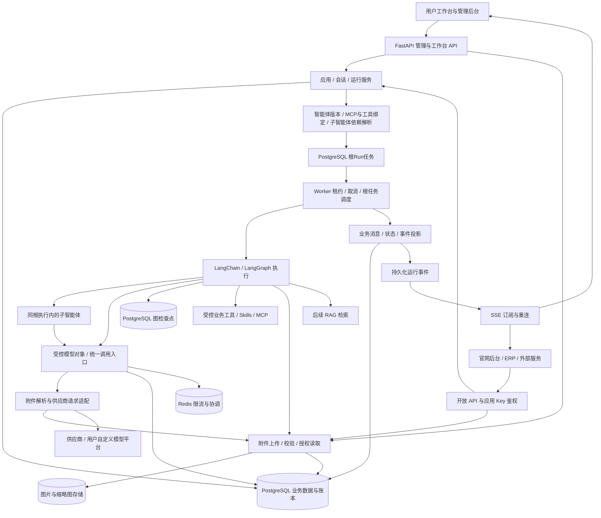

# 可信内部团队 AI 应用平台重构设计

> 创建日期：2026-10-31（Asia/Shanghai）
>
> 更新日期：2026-11-02（Asia/Shanghai）
>
> 版本：v0.7
>
> 状态：设计草案，供评审；不表示以下能力已经实现。
>
> 本轮范围：确定产品方向、架构和实现边界，仅编写文档，不修改业务代码。

本版补齐 P1 实施与交接契约，继续采用分阶段发布：P1 是可独立部署、供内部成员试用的基础版本，后续逐步交付图片、工具、子智能体和业务应用。本轮仅修复文档，尚未进入代码实现。

新接手者先读 [接手与进度说明](refactor-handoff.md)，再读 [P1 实施方案](2026-11-02-p1-implementation.md)。实施方案固定了新工程目录、候选依赖、页面/API、数据字段与约束、账号初始化、默认运行参数和 T01–T07 验收；任务进度与未验证事项以交接记录为准。

**阅读约定：本文描述完整目标架构，具体交付范围以第 16 节为准。第一版/首版仅指 P1 基础版本；后续能力在各自阶段启用时满足对应约束。图中模块、逻辑表和 API 清单不要求在 P1 一次性创建。**

## 1. 目标与已确认需求

将现有基于 AgentScope 的企业智能客服项目，重构为面向可信内部团队的多用户 AI 应用平台。成员由团队管理员开通账号，能够配置自己的模型连接、创建应用、在网页中使用应用，并生成应用访问 Key，将 AI 能力接入团队的官网、ERP 或其他业务系统。

已确认需求：

1. 面向可信内部团队，提供专业的成员工作台和管理后台；默认关闭公开注册。
2. 从 AgentScope 迁移到 **LangChain**，配合 **LangGraph** 管理执行状态和复杂流程。
3. 用户能够添加不同供应商、不同 API 地址和不同 Key 的模型连接。
4. 支持管理员提供公共模型并分配权限和额度；个人模型是核心接入方式，不强制使用公共模型。
5. 用户能够创建应用并管理对外访问 Key，将应用接入官网客服、ERP 智能问数等系统。
6. 提供对话持久化、账号管理、调用记录、Token 监控、使用限制和日志审计。
7. 成员可在前端创建和配置智能体，包括模型、提示词与行为特性、MCP、Tool 和子智能体，并直接进行正常多轮对话与调试。
8. 借鉴 QwenPaw 的产品组织和设计模式，重新实现适合本平台的执行层。
9. 智能体配置按阶段交付：P1 提示词与模型，P3 MCP/Tool，P4 子智能体；RAG、复杂编排和完整 Skills 管理继续后置。
10. 保留完整图片需求：P2 交付网页选择/拖拽/粘贴、多图与图文消息、视觉模型调用、持久化及历史回看；P5 开放 API 时同步支持图片上传与调用。
11. 外部系统通过应用 API 产生的对话必须在后端持久化，并在有权限的成员工作台及管理后台查看消息正文、图片、回复和执行记录，不能仅提供调用次数或日志。

当前设计按可信内部团队使用确定账号开通、访问和部署边界。成员自带模型连接与管理员提供公共模型两种方式同时保留；应用 API 仍可服务官网客服、ERP 等业务入口。

### 1.1 分阶段产品闭环

P1 基础闭环：管理员开通账号 → 首次登录 → 添加个人模型连接 → 创建智能体并设置提示词与模型参数 → 文本对话 → 查看历史、用量和错误状态。无需应用发布或访问 Key，即可供内部成员试用。

P2–P4 逐步增加图文对话、MCP/Tool 配置和基础子智能体，每阶段完成后可以独立更新部署。P5 才开放业务闭环：团队工作区与模型授权 → 应用发布 → 生成访问 Key → 官网/ERP 后台调用 → 授权后台查看文字、图片、回复及用量。

P1 为成员自动创建个人工作区，资源均保存工作区归属；P5 再实现团队工作区、维护者、团队凭据和平台公共模型分配。数据模型保留扩展边界，P1 不提前建设团队管理页面或全部应用表。内部团队使用不代表默认共享私人对话和模型凭据。

### 1.2 第一版范围与后续能力

P1 只交付账号管理、个人模型连接、基础智能体配置、文本聊天、持久化历史、基础计量与限制、必要日志及部署恢复能力。首批验证一种兼容聊天协议，支持成员配置不同地址和 Key；其他原生协议按实际需求增加。

- P2：图片上传、视觉模型适配、图文历史及授权附件存储。
- P3：MCP 连接与工具发现、平台工具、受控 HTTP 工具。
- P4：一层串行子智能体委派、父子执行状态和统一计量。
- P5：团队资源、公共模型授权、应用发布、访问 Key、开放 API 与后台 API 对话查询，图文能力同时开放。
- P6：官网客服等原有业务迁移；P7：RAG 与完整 ERP 问数按需求分别推进。
- P8：嵌入式 SDK、复杂协作、多渠道、定时任务和复杂编排，按实际价值另行排期。

公开注册、商业 SaaS 运营、支付清算、任意用户代码/插件执行、跨工作区应用市场均不属于当前建设范围。自定义域名、多区域和 Kubernetes 不作为早期部署前置条件。各阶段完整边界与验收见第 16 节，未交付功能不展示可操作的占位入口。

## 2. 当前项目评估与迁移资产

以下结论基于当前工作区源码，而非只依据 README。

| 当前实现 | 主要问题 | 重构处理 |
| --- | --- | --- |
| `BE/src/app.py`：FastAPI、REST、SSE | 路由与会话、框架消息耦合；认证依赖配置中的 API Key | 保留 FastAPI，拆分身份、应用、会话和执行服务 |
| `BE/src/agent.py`：`InMemoryMemory`、进程内会话字典 | 重启后不能恢复完整上下文，多进程状态不共享 | 业务记录写 PostgreSQL，图状态使用持久化 checkpointer |
| `FE/my-chat-app/src/App.tsx`：浏览器保存历史 | 历史以本机为中心，不能跨设备同步 | 后端作为权威记录，浏览器只保存缓存和草稿 |
| `FE/my-chat-app/src/api.ts`：前端配置访问 Key | 不适合成员身份识别与独立授权 | 工作台使用登录会话，外部系统使用独立应用 Key |
| 全局 DeepSeek 配置 | 不支持用户级连接与动态模型授权 | 引入连接、凭据、模型目录和模型授权 |
| 按角色定位 `MEMORY.md` | 缺少用户级记忆边界 | 公共角色内容保留，私有记忆改为按归属存储 |
| `agents/`、`skills/`、`runtime_config.py` | 有可复用的业务规则，但绑定当前执行框架 | 迁移内容和配置语义，重写框架适配 |
| 产品导航、专业子 Agent、MCP 工具 | 已有业务价值，需要重新接入运行时 | 分阶段迁移，保留产品导航的业务事件语义 |

现有公司客服作为未来平台中的一个应用或模板。角色 Markdown 是业务资产，通过受控的应用配置和版本管理维护。原有 `AGENTS.md` 属于项目业务角色配置，不等同于新平台的权限系统。

## 3. QwenPaw 调研与借鉴边界

调研时间为 2026-10-31。源码基准为官方仓库提交 `c26d31c0688aa9cce9bc1aef688177d2e14e25df`，它是本次调研的主分支快照，不代表所有能力已包含在某个稳定发布版本中。

| 关注点 | 官方源码或文档体现的实现 | 本平台采用方式 |
| --- | --- | --- |
| 前端 | React、TypeScript、Vite，使用 Ant Design 等组件，存在单独设计规范 | 保留技术栈，建立自己的布局、主题和状态规范 |
| Hub | 集中管理账户和用户 Runtime，支持 Local/Docker Provisioner | 借鉴管理和执行分离，第一版采用共享应用服务 |
| 模型 | Provider 封装发现、连接测试、模型参数和协议差异 | 建立 Provider Adapter 与模型目录 |
| 组织模型 | Hub 持有上游凭据，运行环境使用内部凭证访问模型网关 | 平台 Key 仅在后端使用，外部应用 Key 不暴露上游 Key |
| Token | 模型包装器收集 usage，Hub 网关维护预算请求账本 | 所有平台内调用统一归属、统一计量 |
| 预算 | 请求前事务预留，完成后结算；处理缺失 usage、取消和重启 | 引入明确的预留、结算及待核对状态 |
| 持久化 | 存在 JSON 会话与索引实现；Hub 使用 SQLite | 借鉴存储接口，替换为适合本平台的 PostgreSQL |
| 扩展 | 工作区、注册表、工具、Skills、MCP、生命周期钩子 | 保留扩展边界，使用 LangChain/LangGraph 实现执行 |

需要区别对待的事实：

- QwenPaw 本身仍以 AgentScope 为基础；本项目不直接沿用其 AgentScope 执行代码。
- 官方 Hub 文档限定当前版本面向可信内部团队，与本项目定位一致。可以借鉴其账号与运行环境管理，但仍需落实成员资源授权、凭据保护和受控工具执行。
- QwenPaw Hub 预算主要覆盖组织托管调用，个人直连不进入 Hub 预算报表；本平台要求个人连接也经过统一后端计量。
- 已检查的 Hub 限流器含进程内计数。本平台多实例部署采用共享限流状态，不直接复制该实现。
- Provider 支持范围不能等同于 Hub 网关在某一版本中的协议支持范围；实施时按固定版本逐项验证。

参考实现与原文链接见第 18 节。上述是调研事实；下文是本项目建议设计。

## 4. 核心设计决策

| 编号 | 决策 | 理由与边界 |
| --- | --- | --- |
| D01 | 模块化单体，一个后端代码库，可分别运行 API 与 Worker | 先保证业务一致性，按负载拆进程，不提前拆微服务 |
| D02 | React + TypeScript + Vite + Ant Design | 沿用 React 基础，在新平台引入 Ant Design，补齐管理页面和交互体系 |
| D03 | FastAPI + Pydantic | 承载工作台 API、开放 API 和 SSE |
| D04 | LangChain + LangGraph | LangChain 负责 Agent、模型与工具；LangGraph 负责状态、编排及检查点 |
| D05 | PostgreSQL + SQLAlchemy + Alembic | 持久化业务数据，管理事务与数据库迁移 |
| D06 | Redis 纳入团队部署基线 | 存储 API 与 Worker 间共享限流、短期协调状态；不作为额度和对话唯一来源 |
| D07 | 第一版用 LangChain 模型适配器实现统一模型访问层 | 首批接入兼容接口；需要原生能力时增加原生适配器 |
| D08 | LiteLLM 为后续可选网关 | 大量供应商、Key 池和复杂路由出现时评估；不能形成两套重复扣额账本 |
| D09 | 业务消息与图检查点分开存储 | 历史查询与导出不依赖框架内部状态格式 |
| D10 | 智能体执行快照与应用发布版本不可变 | 草稿编辑不改变已有会话、线上应用和在途执行 |
| D11 | 个人、团队自有和平台公共模型分别归属、分别限额 | 明确供应商费用承担者，公共额度不承担自有连接调用 |
| D12 | 第一版不开放任意代码和任意插件执行 | 在共享服务中仅执行经过平台审核的工具 |
| D13 | 默认由管理员开通账号，工作台部署在受控网络 | 面向单一可信内部团队，官网访客通过业务应用接入，不成为平台成员 |
| D14 | 智能体配置与应用发布分离 | 成员可直接配置和聊天；需要业务系统接入时再创建应用 |
| D15 | 前端可配置 MCP、工具和受控子智能体 | P3 交付工具配置，P4 交付基础主从调用，复杂流程画布后置 |
| D16 | 图文消息统一内容块，图片由独立附件服务保存 | 网页和 API 共用上传、授权、模型适配与历史回看能力 |
| D17 | API 对话与网页对话同等持久化、可在后台查询 | 消息正文是业务数据，调用统计与普通日志不能替代对话历史 |
| D18 | Worker 只调度根 Run，子智能体在根执行内等待完成 | P4 子调用不创建独立队列任务，避免重复调度与 Worker 池互相等待 |
| D19 | 业务记录、检查点、事件、用量各有权威用途 | 通过稳定消息 ID、检查点输入游标和结果投影同步，不重复追加整段历史 |
| D20 | 正式应用归团队，创建者与执行身份分离 | 员工离职撤销管理权，团队应用按自身策略继续运行 |
| D21 | 模型调用仅由受控模型对象执行，统一入口独占重试 | SDK、Worker 和图节点不能各自隐藏重试并漏记消耗 |
| D22 | 模型请求前解析平台图片引用 | base64、临时 URL 和认证信息不进入持久化图状态 |
| D23 | 首版用 PostgreSQL 任务记录直接领取 | 根 Run 与任务同事务创建；接外部队列时才启用 outbox 投递 |

P1 候选依赖与解析结果见实施方案第 2.2 节，T01 必须安装并完成行为验证后生成锁文件；本设计不将动态的“最新版”作为可复现构建约束。LangChain SDK、LangGraph 与平台业务服务可自行部署，不以购买托管服务作为前提。

## 5. 用户、工作区与权限

### 5.1 身份模型

P1 实现账号、个人工作区和成员权限；团队 Membership、Integration、ExternalUser 与 Application Principal 在 P5 实现。以下为完整身份模型。

- **平台账号 User**：由管理员开通的内部成员登录主体，可拥有工作区。
- **工作区 Workspace**：区分 personal/team，均为应用、连接、数据和用量的归属边界；成员自动获得个人工作区，管理员创建团队工作区。
- **成员 Membership**：个人工作区启用 owner；团队工作区由管理员指定 owner、maintainer、reader，资源编辑与会话内容查看可进一步授权。复杂邀请与协作流程后置。
- **平台管理员**：管理账号状态、公共模型和平台策略。管理员身份不自动变成用户模型凭据读取权限。
- **外部终端用户 ExternalUser**：某个应用的访客或员工，不必注册平台账号。
- **集成身份 Integration**：代表调用应用的外部服务，可拥有多把轮换或分环境的访问 Key。
- **应用执行身份 Application Principal**：代表已发布应用运行，权限来自应用绑定的资源授权与调用 scope；创建人仅作为审计字段，不自动成为每次 API 调用的权限主体。

角色授权与资源归属同时检查。服务端根据登录态或 Key 解析工作区，不能信任请求体自行声明的 `workspace_id`、计费主体或工具权限。直接聊天按成员授权执行；应用调用同时检查调用入口权限、应用执行身份及发布版本资源授权，后台维护者权限不自动传递给外部调用者。

| 操作 | 工作区所有者 | 外部应用 Key | 平台管理员 |
| --- | --- | --- | --- |
| 配置个人模型与应用 | 自己工作区内允许 | 不允许 | 默认不代替用户操作 |
| 配置团队应用与连接 | 团队 owner/maintainer 在资源授权范围内允许 | 不允许 | 指定维护者、管理团队资源授权 |
| 配置智能体、MCP、工具和子智能体 | 可创建自己的配置并绑定有权使用的资源 | 不允许修改执行配置 | 管理资源目录、目标访问策略和禁用状态 |
| 调用已发布应用 | 按模型授权与额度允许 | 按应用、操作 scope 和额度允许 | 按授权，不绕过账本 |
| 查看历史与执行结果 | 自己工作区内允许 | 仅授权应用及集成身份范围 | 仅明确授予的支持/审计权限，留痕 |
| 获取已有 Key 明文 | 不允许，只能替换或重新生成 | 不允许 | 不允许 |
| 管理公共模型、禁用用户 | 不允许 | 不允许 | 允许并审计 |

### 5.2 登录与生命周期

工作台优先采用服务端可撤销会话与 `HttpOnly`、`Secure` Cookie，配置 SameSite、CSRF 防护和精确的跨域来源。外部开放 API 使用 Bearer 应用 Key，不混用工作台 Cookie。

默认关闭公开注册，由管理员创建成员账号，并通过受控渠道交付一次性激活凭据；首次登录设置个人密码。保留登录限流、密码安全散列、会话撤销和管理员重置流程；重置时旧会话失效。管理员启用多因素认证。邮件邀请和企业 SSO 作为后续可选接入，不将公开注册邮件验证作为第一版前置条件。

账号开通不等于自动授予公共模型额度，管理员可设置成员默认模型权限和额度，并按需单独调整。成员离职或账号禁用时，撤销其登录会话、团队维护权限和个人工作区应用的新调用权限；已经发出的上游请求仍需结算。团队应用的 integration 和 Key 归团队应用，创建者禁用不自动撤销它们；若存在凭据泄露等情况，管理员独立撤销受影响的业务 Key。团队工作区、应用或执行授权被禁用时，在后续模型/工具边界阻止新调用。

### 5.3 团队信任与业务访问边界

平台成员是团队认可的内部人员；基础设施管理员属于可信运维边界，可接触主机和备份，不承诺对基础设施管理员隐藏数据。应用层仍按最小权限保护成员的会话、凭据和业务数据，并记录管理访问。

平台采用共享后端，P3 起增加受控工具，不要求每个成员独立容器或虚拟机。内部身份不会消除误操作、恶意输入或工具越权风险，资源归属检查、出站策略和用量控制仍然有效。

官网访客不属于可信平台成员。访客仅通过官网后台或后续短期访客凭证使用指定应用，不能进入工作台、创建模型连接或访问其他应用。本文“开放 API”表示供业务系统集成的接口，不代表开放管理后台或允许任意互联网用户注册。

### 5.4 正式业务应用的归属与交接

个人工作区用于个人试验和私有应用，团队工作区用于需要持续服务的官网、ERP 等正式应用。团队应用记录 `created_by` 和维护者，实际所有权由 `workspace_id` 决定；替换维护者不改变 app ID、integration、业务 Key 或历史会话。

- P5 团队正式应用只允许依赖团队拥有的模型/MCP/HTTP 凭据，或明确授权给团队的公共模型。不能发布仍依赖某个员工个人凭据的版本。
- 将个人配置用于团队业务时，先复制智能体、工具和子智能体配置，重新绑定团队连接，再验证、发布；不自动复制私人凭据或绕过工作区归属。
- P5 个人应用转为团队业务采用新建团队应用并切换业务入口，提前安排新 Key 与端点替换。旧 app ID 和历史仍保留原归属，不声称支持跨工作区原地迁移全部依赖。
- 团队应用用量归团队及应用，记录触发者用于追溯；创建者离职不把费用转移到其他成员的个人额度。
- 维护角色变更、资源授权、Key 撤销和业务迁移均审计；团队会话内容的可见权限独立于维护角色。

## 6. 模型连接与两类 API Key

### 6.1 模型资源

| 对象 | 内容 |
| --- | --- |
| Provider Adapter | 接口协议、参数映射、usage 解析、错误转换和能力检测 |
| Model Connection | 所有者、API 地址、凭据引用、协议、超时、状态、连接版本 |
| Model Definition | 上游模型名、展示名、上下文/输出上限、流式/工具/结构化输出/图片输入能力、图片格式/尺寸/数量限制及视觉参数 |
| Model Grant | 允许使用该模型的工作区、使用入口和约束 |
| Pricing Version | 币种、输入/输出/缓存等定价规则、生效时间与来源 |

同一供应商允许多个连接，一条连接允许配置多个模型。模型能力需经适配器声明或测试验证，不能因接口宣称兼容就默认支持所有参数。连接测试可能产生真实费用，应明确提示并记录测试调用。

图片输入能力使用明确的支持/不支持/待验证状态。用户自定义接口需要验证图文请求以及与流式、工具调用组合时的行为；不能因为文本测试通过就标记支持视觉。平台可完整支持上传链路，但图片理解仍要求上游模型支持视觉。

个人连接仅在所有者的个人工作区可用；团队连接由有权成员在团队工作区创建，绑定团队凭据。平台公共模型单独设置成员/工作区及网页/API 使用权限。应用持有稳定模型引用，服务端解析实际连接；调用者不能在推理请求中临时注入地址或上游 Key。

### 6.2 两类密钥的存储区别

| 密钥 | 谁提供 | 使用方式 | 保存方式 |
| --- | --- | --- | --- |
| 上游模型 Key | 用户或平台管理员 | 服务端调用供应商时使用原值 | 认证加密保存，密钥与数据库分离，支持版本和轮换 |
| 应用访问 Key | 本平台生成 | 外部服务通过 Bearer 鉴权 | 高熵随机值，仅创建时展示，保存前缀与校验摘要 |

两类 Key 均不写入提示词、图检查点、普通日志和前端持久化存储。查询接口只返回脱敏值和元信息。上游凭据的后端解密能力不等于运维人员可以在管理页面查看明文。

每个应用可有多个集成身份和多把 Key；Key 包含应用绑定、集成绑定、scope、有效期、状态、限流/额度策略、创建人审计字段和最近使用时间。其所有权属于应用及工作区，团队 Key 不绑定创建人的登录会话生命周期。轮换时可短期并存两把 Key，旧 Key 到期或撤销后不再接受新调用；在途调用保留原 Key 归属记录用于结算。

### 6.3 自定义 API 地址

支持用户填写符合首批支持协议的 HTTPS 地址，不提供任意代码适配器上传。模型连接测试、模型发现和正式调用必须走同一出站访问策略：

- 限制协议和端口，禁止 URL 内嵌凭据。
- 默认拒绝未授权的内部目的地址；管理员可按连接用途配置内网模型服务的主机、端口和路径白名单，成员不能自行扩大范围。回环、链路本地、云元数据及无关管理端点仍禁止访问，策略覆盖 IPv4/IPv6。
- 校验 DNS 解析结果，连接时落实目标限制；重定向默认关闭，确需开启则逐跳复核。
- 设置连接/读取超时、请求和响应大小上限，不将内部错误或凭据原样返回。
- 配合部署网络出站限制，避免仅靠一次字符串校验防护。

第一版可通过管理员白名单连接团队内网的兼容模型服务。个人电脑上的本地服务需要明确的可达地址和授权，不能把服务端的 `localhost` 当作成员电脑。内网 ERP 的完整数据访问在后续通过受控连接器/代理接入，网络连通许可不替代员工数据权限。

## 7. 智能体配置、正常对话与应用发布

**智能体 Agent** 定义“如何回答和完成任务”：模型、提示词、行为特性、工具、MCP、子智能体、上下文策略和执行限制。**应用 Application** 定义“如何提供给某个业务使用”：绑定智能体版本、输入/输出 Schema、终端用户规则、调用限制和 API 发布方式。一个智能体可以被多个应用复用，每个应用拥有独立的会话、Key 和用量视图。

成员可在“我的智能体”中直接创建、配置和聊天，无需先申请应用访问 Key。应用中的模型、提示词、工具和知识库来自绑定的智能体版本；P5 应用发布不另设一份容易与智能体冲突的同名配置，业务差异通过复制智能体或新建版本表达。

P5 应用接入支持两种调用语义：聊天应用支持多轮会话；任务应用接受结构化输入并返回一次执行结果。复杂流程和可视化编排后置，底层均使用 Run 描述执行。

### 7.1 应用生命周期

草稿 → 调试 → 发布为不可变版本 → 激活；后续可以停用或将激活版本回滚到历史版本。

- 工作台保存草稿使用版本号或 ETag，拒绝覆盖其他编辑者的新版本。
- 发布前验证绑定的智能体版本、模型授权、MCP/工具绑定、子智能体依赖与输入/输出 Schema。
- 调试只能由工作区授权用户发起，同样计量，不向外部 Key 暴露草稿。
- 应用执行绑定激活的 `application_version_id` 及其引用的 `agent_version_id` 和完整依赖清单；现有会话固定版本，切换版本显式新建会话。
- 每次运行保存执行配置快照和价格版本；凭据只保存引用，秘密原值不进入快照。
- Key 撤销、模型下架和账号禁用属于实时策略，可阻断旧版本的新调用。版本固定不能绕过授权撤销。
- 第一版模型失败不跨个人、团队自有或平台公共模型自动切换。未来回退配置也必须明确模型、费用归属和授权。

用户自定义的是应用能力、输入输出和发布配置。P5 开放 API 使用平台统一的版本化 URL，不开放任意路由处理代码或自定义 HTTP 服务。

### 7.2 示例场景

**官网客服**：在团队工作区创建正式客服应用，绑定团队连接或获授权的公共模型、客服提示词和产品工具；网站后台持应用 Key，平台按访客标识维护会话。个人工作区可先试验，正式接入前完成团队资源绑定。产品导航通过结构化业务事件返回，客户端校验可导航域名后执行。

**ERP 智能问数**：ERP 后台调用已发布问数应用，并传递经自身认证的员工身份。后续数据连接器依据身份应用数据权限，先支持只读查询，限制查询时间、扫描/结果规模和数据导出。模型生成 SQL 不构成数据授权，不能只靠字符串检查 `SELECT` 保证只读。

**内部知识助手**：应用绑定的智能体定义知识库范围，后续检索按工作区、应用和终端用户权限过滤，回答返回来源引用。

### 7.3 智能体配置页面

P1 仅启用基本信息、提示词、模型、基础上下文与执行限制；图片、MCP/Tool、子智能体配置分别在 P2、P3、P4 启用。

页面采用“配置区 + 对话预览区”的布局，也提供独立的正常聊天页面。可视化配置以表单、列表和选择器为主，第一版不要求流程画布或手写服务器配置文件。

| 配置分组 | 成员可设置的内容 | 生效规则 |
| --- | --- | --- |
| 基本信息 | 名称、头像、描述、使用场景、开场白、推荐问题 | 属于当前个人/团队工作区，按资源授权编辑 |
| 提示词与特性 | 角色定位、目标、知识边界、语气、语言、回答长度、输出格式、系统提示词与模板变量 | 保存结构化配置和最终渲染版本，变量限定类型与长度 |
| 模型 | 选择当前工作区可用的个人/团队/公共模型，配置受支持的温度、输出长度和推理选项 | 前端按能力显示参数，后端再次校验授权和能力 |
| 上下文 | 历史窗口、上下文压缩策略、最大输入，后续长期记忆开关 | 原始历史保留，私有记忆不自动共享给其他智能体 |
| 图片输入 | 是否接受图片、每条数量/大小/像素限制、模型支持的图片细节选项 | 使用已验证的视觉模型；所有限制取平台与供应商允许范围的交集 |
| MCP | 创建连接、测试、发现工具、按工具选择启用、超时和失败策略 | 凭据加密，工具 Schema 与绑定版本保存 |
| Tool | 选择平台工具，配置工具参数和凭据引用，定义允许的 HTTP 工具 | 不要求成员编辑 Python 文件；受目标和执行策略约束 |
| 子智能体 | 选择当前工作区有权使用的智能体、配置委派用途、输入上下文、返回格式和调用上限 | 固定子智能体版本，校验依赖环和权限 |
| 执行限制 | 最大轮次、模型/工具调用次数、超时和子智能体调用上限 | 成员设置只能收紧管理员上限 |
| 后续知识与 Skills | 知识库、检索参数、声明式 Skill 绑定 | 按后续阶段实现，沿用同一版本机制 |

角色、语气等结构化字段与高级系统提示词采用明确的渲染顺序：平台固定约束 → 成员角色/行为配置 → 成员补充提示词 → 本次业务输入。预览显示成员可见的渲染结果和变量示例；不展示平台秘密，也不将提示词当作权限校验。模型是否遵循语气或长度仍需通过对话评估，不能把自然语言偏好视为强制执行保证。

### 7.4 MCP 连接配置

成员可创建自己的 MCP 连接，填写名称、服务地址、传输类型和认证信息，并在页面执行“测试连接 → 发现工具 → 查看参数 → 选择工具 → 绑定智能体”。P3 优先支持远程 Streamable HTTP；其他传输方式根据实际服务兼容性扩展。`stdio` 涉及服务器进程启动，作为后续管理员托管能力，不在普通成员表单中执行任意启动命令。

- 管理员提供可复用的团队连接目录；成员也可添加自己的连接，无需管理员逐项代填。内网目的地址受管理员白名单约束。
- MCP 的 endpoint、认证 Header 等秘密配置与模型连接分开保存，共用凭据存储基础设施。后端完成测试、发现和调用，前端不直接持 Key 连接 MCP。
- 默认仅启用成员明确选择的工具。远端新增工具不会自动进入已有智能体版本；工具名称、Schema 或能力变化后提示重新发现、确认并发布新版本。
- 工具标识按连接与工具名命名空间区分；发布时验证 Schema 和参数约束，不能仅依赖远端提供的“只读”标签决定执行权限。
- 可选工具不可用时按配置降级并返回可见状态；必需工具不可用时拒绝相应执行。认证失败不静默切换到其他人的凭据。
- 业务聊天会话与 MCP 协议会话分别管理。默认 MCP 客户端在根 Run 资源作用域内创建和释放；无状态服务可使用按调用模式。不得因为业务会话存在数天就常驻连接数天。
- 真正需要跨轮协议状态的服务须显式配置，由连接管理器按工作区、有效身份、连接版本和业务会话维护隔离映射，并设置空闲 TTL、总连接数及关闭策略。远端状态无法恢复时明确失败，不能凭本地图检查点假定远端会话仍存在。
- HTTP 网络连接池与 MCP 协议状态分离，认证信息按请求绑定；共享连接池不等于共享终端用户的协议会话或 Cookie。取消、超时、凭据轮换按策略关闭受影响资源；Run 结束释放默认运行作用域资源，显式跨轮会话交还连接管理器并受 TTL/容量策略管理。

### 7.5 Tool 配置

P3 提供三种工具来源：平台内置工具、MCP 发现工具、成员定义的 HTTP 工具。成员定义 HTTP 工具时，可配置名称、描述、固定目标、方法、允许的路径/查询/请求体模板、输入与输出 Schema、认证引用、超时和响应字段映射。

路径与参数映射使用受限模板，禁止执行任意 Python/JavaScript 表达式；不允许模型参数改写目标主机、认证 Header 或权限身份。HTTP 工具复用出站访问策略。成员可调整调用描述和业务参数，但不能扩大管理员授权范围或伪装工具副作用类别。

P3 优先提供平台审核的无副作用工具和已确认只读的 HTTP/MCP 操作；HTTP 方法本身不能证明只读。写入类工具先保存配置但不启用，后续补充审批、幂等和恢复机制后再开放。工具测试同样验证身份、目标策略、超时和权限，并保留调用记录。

### 7.6 子智能体配置与执行

P4 采用“主智能体将子智能体作为可调用工具”的委派方式。成员可以选择已有智能体作为子智能体，分别配置名称、委派描述、任务输入 Schema、允许传递的上下文、结果格式和调用上限；子智能体保留自己的模型、提示词、MCP 和工具配置。

- 默认允许一层主从委派且串行执行；依赖图禁止自身引用和间接循环，嵌套深度、调用次数和总时长均受平台上限约束。并行分支和复杂多层编排后置。
- 主智能体只传递任务所需的消息或结构化上下文，默认不传递整段私有历史、长期记忆或凭据。
- 子智能体的有效能力是“子智能体配置、委派边界和当前调用者授权”的交集。内部成员使用与外部应用调用仍采用各自的有效权限。
- 子调用记录 `parent_run_id`、`root_run_id` 和智能体版本，使用独立检查点命名空间；结果作为工具输出回到主智能体。P4 子调用记录不是独立队列任务，根 Worker 在同一次执行中等待它完成，不占用另一个队列执行名额；网络 I/O 使用异步等待，不阻塞整个进程。
- 所有子调用继承根任务的工作区、调用身份和计量主体，共享根任务预算；个人/团队/公共模型额度按子调用实际使用的模型归属结算，必须拥有相应授权。父调用的汇总视图不重复计费。
- 根任务取消时向子调用传递取消；子调用失败按配置返回可识别错误或结束主任务，不能无限递归或重试。子调用使用独立短期上下文，默认不跨根任务保留对话记忆；持久检查点用于当前执行恢复，不自动成为跨任务长期记忆。

### 7.7 正常聊天、调试与版本一致性

成员保存有效智能体配置后即可新建对话，支持历史切换、多轮输入、流式回答、停止生成、工具/子智能体执行状态、失败提示和用量展示；未绑定工具或子智能体时也能正常聊天。工具与子智能体执行轨迹可折叠查看，不要求显示模型内部推理文本。

直接聊天和调试使用服务端生成的不可变智能体执行快照，保存 `agent_version_id` 及依赖清单，即使该版本尚未对外发布。调试使用独立会话，不污染正常对话；配置面板的未保存内容不直接进入执行。修改配置后，对新会话生效；已有会话明确显示原版本，并提供“使用新配置开始对话”。

应用发布固定主智能体、子智能体和工具绑定版本。执行前检查 MCP 实际工具 Schema 与固定快照是否兼容，不兼容则报错并要求重新验证。远端服务实现本身不受本平台版本控制，保存 Schema 快照只能保证调用契约，不能承诺远端行为完全可重现。

直接聊天允许没有 `application_id`，以登录用户、工作区和智能体版本确定归属。成员在工作台使用已发布应用时记录应用归属，仍以登录会话鉴权，不要求创建访问 Key；外部系统调用则必须具有应用、integration 和访问 Key。各入口共用 Run、消息、事件、计量和检查点服务。直接聊天不受不存在的应用/Key 额度约束，仍遵守成员、工作区、模型与平台限制。

### 7.8 图片上传与多模态对话

图片输入覆盖成员直接聊天、调试、工作台应用聊天和外部应用 API；不只是在输入框显示附件图标。P2 支持网页 JPEG、PNG、WebP 静态图片的完整链路，P5 将同一能力用于外部 API，可发送单图、多图、纯图片及文字与图片混合消息。其他格式、动画或超限图片明确提示支持范围，不能静默丢帧或当作文本发送。

**网页交互**：支持文件选择、拖拽和剪贴板粘贴，展示缩略图、数量、上传/处理进度、错误和重试；发送前可移除附件，处理就绪后才允许提交。发送后消息内显示图片，可在授权下放大查看。刷新、换设备和服务重启后，历史中的图片仍可通过后端重新加载。

**上传和调用流程**：

1. 先创建/取得有权访问的会话，再向附件接口上传二进制文件，得到稳定 `file_id`。
2. 后端检查文件实际类型、可解码性、尺寸、像素和大小，生成规范化图片及缩略图；状态达到 `ready` 后才允许绑定消息。
3. 提交 Run 时引用图片 `file_id`，后端再次校验会话归属、文件状态和模型能力，并将有序的文字/图片内容块及附件关系持久化。
4. 执行时由 Provider Adapter 把内容块转换为供应商接受的多模态格式，使用实际图片数据、供应商文件句柄或临时读取地址；不能只把文件名或 URL 当作普通文本交给模型。
5. 回复、图片引用、处理版本及运行状态一起进入业务历史，可在前端和后台回看。仅存在于浏览器的 `blob:` URL 不作为持久化标识。

P2 暂定图片上限为每条消息 4 张、每张 10 MiB、解码后不超过 2000 万像素，作为可配置默认值，实施时按实际模型验证调整；供应商限制更低时按更低值执行，前端和后端共同校验。上传存储空间和带宽配额独立于 Token 配额。

模型不支持或尚未验证视觉时，在调用前返回 `model_image_input_unsupported`；输入框提示选择合适的智能体/模型。已有会话绑定旧版本时，引导使用新配置新建会话，不暗中改模型或费用归属。视觉模型返回参数错误时明确报错，不删除图片后重试，也不自动用 OCR 文本代替原图。

多轮上下文按配置保留图片内容块，在每次模型请求时解析可用附件；历史图像再次发送产生的供应商用量正常计入。上下文压缩需要记录哪些图片被移出模型上下文或替换为摘要，但原始业务历史仍可查看。子智能体只有在允许的上下文范围内且支持图片输入时才接收图片引用，不可越过附件权限或静默忽略图像。

**存储与访问**：图片不放入数据库大字段或普通日志。PostgreSQL 保存附件归属、对象引用和元数据，独立存储服务保存原始及派生对象；访问采用带鉴权的读取接口或短期签名地址。原始文件限制下载权限，预览/模型使用经过校验与规范化的图片，默认移除非业务必需的 EXIF 信息，并记录实际发往上游的图片版本。图片不作为公开静态资源暴露。

未发送的附件按待绑定生命周期清理，正在处理或被活动 Run/消息引用的对象不被当作孤儿删除。临时 URL 不写成唯一永久引用，恢复执行或历史回看时重新鉴权并签发；附件确实被清理时显示“图片已删除/过期”，不伪装成仍可读取。P5 API 接受文件上传后引用，不抓取调用者任意提供的远程图片 URL。

图片请求数据采用以下固定转换边界：

| 层次 | 保存/接收的图片表示 | 生命周期 |
| --- | --- | --- |
| 业务消息与图检查点 | 平台 `file_id`、派生图片版本、MIME 等稳定元数据 | 按会话与附件保留策略持久化 |
| 附件解析器 | 校验有效身份与根会话授权，读取指定规范化图片 | 每次模型尝试前执行，不更改持久化消息对象 |
| Provider Adapter | base64、临时读取 URL 或供应商文件句柄 | 仅存在于当前请求载荷；临时读取凭据不写回 checkpoint/trace |

平台内容块类型与供应商/LangChain 内容块分开，在受控模型对象内部转换，不能把平台 `file_id` 原样当作供应商文件 ID。图状态及消息中的图片引用在模型入口临时展开，调用完成后只投影允许保存的结果元数据；禁止把含 base64 或签名 URL 的临时请求对象写回图状态。

需要缓存供应商文件句柄时，以平台图片版本、供应商、连接身份及凭据版本共同定位，记录过期/撤销状态，不跨连接复用。子智能体只获得根 Run 授权下的图片引用及委派权限，不因独立子检查点而绕过附件归属，也不把附件重新绑定到另一会话。

## 8. 总体架构与模块职责

下图是完整目标架构。P1 只实现工作台/API、模型连接与基础配置、根任务/Worker、LangChain/LangGraph、统一模型入口、PostgreSQL、Redis 与 SSE；附件在 P2、工具在 P3、子智能体在 P4、团队应用与开放 API 在 P5 加入，RAG 属于 P7。



API 与 Worker 共用业务代码和策略实现，可独立扩容。首版在同一个 PostgreSQL 事务中创建根 Run、输入消息和 `execution_jobs`，Worker 直接以条件更新/行锁领取待执行任务，不再平行维护一套 outbox 投递流程。将来引入外部队列时再增加事务 outbox，队列消息仅携带任务标识，数据库仍保存权威状态。

任务可能被重复领取或重新投递。Worker 使用租约、单调执行 fencing token 和状态条件更新避免旧执行覆盖新结果；模型/工具调用前重新检查执行权。fencing 保护数据库写入，不能撤回已发出的上游请求，因此不能承诺模型或外部工具恰好执行一次。

| 模块 | 职责 | 不承担的职责 |
| --- | --- | --- |
| identity / workspaces | 登录、成员、资源归属与授权 | 模型参数转换 |
| model_connections | 连接、密钥引用、模型能力和授权 | Agent 业务编排 |
| agents / agent_configs | 智能体草稿、提示词渲染、执行快照、子智能体依赖验证 | 将任意用户代码注入运行进程 |
| applications | 草稿、版本、发布、集成身份和应用 Key | 明文凭据展示 |
| conversations / runs | 会话、消息、任务生命周期、运行事件 | 供应商计费规则推断 |
| files / attachments | 图片上传、类型与像素校验、派生图片、对象存储、附件授权和清理 | 把文件路径直接公开或把图片当作 RAG 文档自动入库 |
| agent_runtime | LangChain/LangGraph 适配和受控执行 | 自行绕过统一入口创建模型客户端 |
| model_access / metering | 调用准入、协议适配、usage 标准化、结算 | 平台账号管理 |
| tools / connectors | 成员工具配置、MCP 测试与发现、工具注册、凭据注入、身份与执行权限 | 依赖提示词执行权限限制 |
| audit / observability | 审计、指标、链路关联 | 作为额度的唯一数据源 |
| knowledge（后续） | 文档处理、索引、检索和引用 | 替代业务聊天记录 |

上述为逻辑模块，P1 工程固定采用实施方案第 2.1 节的 platform/ 独立目录，与旧 BE/FE 并存。框架对象不直接暴露为公共 API 数据结构；外部协议通过平台自己的消息与事件模型保持稳定。

### 8.1 执行职责与运行上下文

| 执行组件 | 唯一负责的事情 | 明确禁止的重复职责 |
| --- | --- | --- |
| API / RunService | 入口鉴权、输入验证、创建根 Run 与任务、查询/取消 | 不在 HTTP 请求结束后依赖进程内临时任务维持业务执行 |
| Worker | 根任务领取、租约心跳、执行权、超时、取消和恢复扫描 | 不重新实现 ReAct 循环，不为同步子调用另起队列任务 |
| LangChain `create_agent` | 模型—工具循环、middleware、子智能体工具调用 | 不直接创建绕过准入与计量的供应商客户端 |
| LangGraph | 图状态、检查点、需要时的确定性分支/子图 | 不替代成员鉴权、业务消息表或额度账本 |
| RunProjector | 将可见消息、子执行摘要、状态和事件幂等投影到业务库 | 不为补写业务结果重新调用模型 |
| ModelAccessService | 每个真实上游尝试的鉴权、限流、预留、调用、重试和结算 | 不把图重放或 SDK 隐式重试当成免费操作 |

简单 Agent 直接使用 `create_agent` 与 middleware，只有确定的业务分支需要自定义 LangGraph 图。不额外叠加另一套 Agent 调度框架。

服务端构建不可由请求体覆盖的 `ExecutionContext`：工作区、成员或应用执行身份、入口类型、可选应用/integration/终端用户、根/父/当前 Run、版本清单、授权引用、计量主体、截止时间、取消状态和执行 fencing token。子调用只能继承并收紧权限与预算。上下文以运行期参数注入，秘密原值不进入图状态；持久化仅保存恢复所需的稳定引用，恢复时重新验证权限。

### 8.2 资源创建、缓存与释放

智能体工厂按配置快照创建运行对象，不按用户无限常驻 Agent 实例。可缓存不可变配置、工具 Schema 和经验证不含会话状态的编译结构；缓存键包括版本及能力配置。凭据轮换、资源禁用或配置变更使相关缓存失效，调用前仍进行实时授权。

模型客户端可按连接与凭据版本有限复用，设置缓存容量和空闲释放；不得跨凭据身份复用认证状态。MCP 会话按第 7.4 节管理。Worker 的运行作用域统一释放网络资源、MCP 客户端和临时图片数据，取消/异常路径同样执行清理。

### 8.3 架构图的维护

本节 Mermaid 图为重构目标架构，对应独立源码 [refactor-target.mmd](../diagrams/refactor-target.mmd)。[架构图索引](../diagrams/README.md) 区分现有 AgentScope 系统图与重构目标图；原有 `architecture.excalidraw`、`architecture-uml.html` 保留为旧系统参考，不作为重构实施依据。修改架构关系时同步维护本节和独立图源。

## 9. 数据模型与持久化边界

以下是完整目标的逻辑表设计，不是已生成的 SQL；按功能阶段增加迁移，P1 不创建尚未使用的应用、工具、附件及知识表。通用字段包含稳定 ID、创建/更新时间，涉及用户资源的表包含工作区归属；密钥、账本和事件使用适合各自生命周期的专有字段。

| 领域 | 主要对象 | 关键关系与字段 |
| --- | --- | --- |
| 身份 | users、auth_sessions、verification_tokens | 账号状态、会话撤销、验证用途与过期时间 |
| 工作区 | workspaces、memberships | personal/team 类型、所有权、维护者/读取者及资源权限；用户与工作区关系唯一 |
| 模型 | model_connections、credential_secrets、model_definitions、model_grants | 归属、凭据引用、协议、能力、授权；公共连接使用明确的平台归属类型 |
| 智能体 | agents、agent_versions、agent_tool_bindings、agent_delegations | 草稿 revision、提示词/行为/模型配置、不可变执行快照、工具版本与子智能体依赖 |
| 工具连接 | mcp_connections、mcp_tool_snapshots、tool_definitions、tool_versions | 地址、认证引用、传输、发现状态、Schema 指纹、工具来源和副作用类别 |
| 应用 | applications、application_versions | 工作区所有权、created_by、应用执行身份与资源授权、草稿 revision、激活版本、主智能体版本、Schema、配置快照 |
| 接入 | integrations、application_api_keys、external_users | 应用归属、创建人审计字段、集成身份、Key 摘要/scope、外部用户标识 |
| 对话 | conversations、messages | 智能体版本、可选应用版本、入口身份、消息序号、稳定消息/内容块 ID、有序文字/图片块、状态、投影事件游标 |
| 图片附件（P2） | files、file_variants、message_attachments | 工作区/会话/调用主体归属、状态、MIME、大小、宽高、校验值、对象键、派生版本、消息引用和清理期限 |
| 执行 | runs、run_events、tool_calls | parent/root Run、输入消息 ID、最后确认 checkpoint、状态、fencing token、版本化事件与投影游标、工具调用幂等结果 |
| 任务 | execution_jobs | 仅根 Run 的任务记录、领取状态/租约、恢复状态；outbox_events 在引入外部队列时增加 |
| 用量 | model_calls、model_call_attempts、usage_records | 每次模型调用及上游尝试、原始 usage、规范化 usage、费用估算 |
| 额度 | quota_policies、quota_buckets、quota_reservations、quota_ledger | 额度范围、周期、预留、不可变结算/调整流水 |
| 审计 | audit_events | 操作主体、动作、对象、结果、脱敏差异、关联请求 |
| 知识（后续） | knowledge_bases、documents、chunks、index_jobs | 复用 files，增加知识库授权、文档与索引版本 |

### 9.1 标识与约束

- `auth_session_id` 是登录会话；`conversation_id` 是业务对话；`run_id` 是一次执行。三者不能互相替代。
- `thread_id` 由后端按会话与执行分支生成，只在授权后用于访问图状态。外部调用者不能指定任意 thread。
- 外部用户以 `(application_id, integration_id, external_user_id)` 唯一；不同业务系统中的同名员工不合并。
- 同一应用内轮换 Key 保持 integration 不变，避免换 Key 后丢失终端用户身份与会话连续性。
- `run_events` 的 `(root_run_id, sequence)` 唯一，另存事件实际来源 run_id；消息、工具结果和 usage 的持久化操作须有去重标识。
- 文件引用必须与会话工作区及入口身份一致；外部上传还绑定应用、integration 和外部用户。默认文件只用于上传所属会话，禁止凭可猜到的 file ID 跨会话引用或读取。
- 应用、会话、连接和工具引用通过工作区一致性校验，关键关系使用复合约束避免跨工作区挂接。
- 会话的直接成员入口与应用入口有明确类型约束：前者必须有成员归属和智能体版本，后者还必须有应用版本及有效调用身份；不能通过省略应用字段绕过应用授权。
- 子智能体绑定保存版本 ID，禁止依赖环；工具及 MCP 的凭据、Schema 快照与可见范围单独验证。成员删除被引用资源时提示依赖，禁用资源立即影响新的执行调用。
- API 层和存储层均应用归属检查；PostgreSQL RLS 可作为额外防线，必须验证连接池上下文重置与数据库角色权限，不能仅增加一个 `workspace_id` 字段。

### 9.2 权威数据与消息同步协议

| 数据 | 权威用途 | 不承担的用途 |
| --- | --- | --- |
| messages / runs | 网页、API、管理后台的业务历史和可见执行状态 | 不通过每轮全量追加历史重建已有图上下文 |
| LangGraph checkpoint | 模型上下文、节点与当前执行恢复状态 | 不作为后台查询协议，不含临时图片请求数据 |
| run_events | 有限保留的过程事件、增量展示和重连重放 | 不作为永久唯一消息正文，不通过重放事件调用模型 |
| usage_records / quota_ledger | 真实调用归属、消耗与结算 | 不通过客户端事件统计扣额 |
| 长期记忆 / 知识库 | 跨会话事实、偏好与文档检索 | 不替代原始业务历史 |

业务库与图检查点分开提交，不承诺跨两者的自动原子性。使用如下协议：

1. API 为输入分配稳定 `message_id` 与会话内顺序，在同一业务事务中保存消息、附件、根 Run 和任务。一个 Run 固定引用这组输入，幂等重试不得重新生成消息 ID。
2. 图状态包含稳定消息 ID 及 `applied_input_seq`（已应用的业务输入位置）。正常续聊仅注入高于该位置的新输入；同一消息重试使用相同 ID，消息合并逻辑须验证能去重。不能每轮将 messages 表全部历史追加到已有 checkpoint。
3. 输入位置随对应图状态一起持久化。恢复时读取实际 checkpoint 确定哪些输入已应用，runs 表中记录的 checkpoint ID 只是可核对索引，不单独证明图状态已提交。
4. 模型与工具结果使用稳定调用 ID，图状态保留节点执行结果与可见输出的稳定 ID。RunProjector 将结果幂等投影到 messages；同一调用结果不能被当作一条新的回答再次追加。
5. 最终消息快照、Run 终态和终态事件在一个业务事务中提交，随后发布订阅通知。图已完成但业务提交失败时，从已持久化结果补写投影，不重新执行图。
6. 模型结果已到达但检查点未落盘时，先核对调用记录及可恢复结果；可确认的结果以原调用 ID 注入安全恢复点。无法确认或无法安全恢复时标记 interrupted，不为补全页面无条件重新请求供应商。

后台读取只访问业务记录和授权附件，不调用 `graph.invoke` 或使用旧检查点重新推理。显式重试/重跑是一项新的业务操作，应生成新的 Run 并记录来源 Run，重新进行额度准入。

| 崩溃位置 | 恢复处理 |
| --- | --- |
| 输入与任务已保存，尚无执行检查点 | 重新领取任务，按原 message ID 注入一次输入 |
| 输入已进入 checkpoint，业务 checkpoint 索引尚未更新 | 以实际图状态去重输入，补齐业务索引 |
| 图结果已保存，最终业务消息未提交 | 补写消息、终态与事件投影，不重复模型调用 |
| 业务消息已提交，订阅通知未发出 | SSE 从数据库游标重放；不重新生成结果 |
| 上游结果/外部副作用不确定 | 保留已保存片段，进入 interrupted/待核对流程，不自动免费重试 |

聊天上下文压缩只改变送给模型的内容，不删除原始业务历史。第一版默认同一会话只允许一个活动 Run，重复提交返回已有 Run 或冲突，防止图状态和消息顺序互相覆盖。

### 9.3 删除与保留

删除或停用应用立即阻止新执行；历史记录、文件、检查点和账本按不同保留策略处理。会话删除应覆盖消息、附件、检查点和相关可恢复缓存，不能只删除前端列表项。

审计与结算记录如需保留，应最小化内容并在团队数据使用说明中明确；不能把含完整提示词的 trace 视为永久保留的财务记录。具体保留期限、备份过期和成员离职/注销处理属于上线前必须确定的管理规则。

### 9.4 API 对话持久化与后台查看

本节随 P5 开放 API 一起交付；禁止先开放接口、后续再补对话记录。网页对话历史持久化先在 P1 交付，P5 复用该基础。

无论调用者来自工作台、官网后台还是 ERP，平台接受的对话请求都进入同一套会话和消息存储。应用 API 不提供“绕过业务记录”的默认运行模式；历史可见性不依赖浏览器打开过该会话，也不依赖供应商提供历史查询接口。

后台提供“应用 → 对话记录”和授权管理员的“对话查询”入口：

- 列表支持按工作区、应用、入口来源（工作台/调试/API）、integration、外部用户、访问 Key 标识、时间范围和执行状态过滤；消息正文搜索遵循同一权限与保留规则。
- 详情按消息顺序展示用户文字、图片缩略图/授权预览、助手回复、时间、模型和智能体版本；区分未完成、失败、取消和正常完成的消息。
- 可展开查看 Run、工具/子智能体调用摘要、Token 与费用估算、耗时、错误和 request ID；不展示密钥、内部认证 Header 或模型隐藏推理。
- 应用所在工作区的授权所有者可以查看应用的 API 对话，包括各 integration 下业务用户的消息；外部 API Key 仍只能读取自身授权的 integration 范围。平台管理员需明确的会话内容访问权限，并记录查看/导出审计。
- 查看记录是读取操作，不重新调用模型、不改写历史，也不自动接管正在进行的外部会话。人工客服接管若需要，作为独立功能设计。

接受请求前先完成权限、输入、附件和能力校验；合法请求将用户消息、附件关系和 Run 事务性保存。后续上游报错、断流或取消时保留已接受的输入、已持久化的输出片段和失败状态。未通过鉴权或参数校验的请求只记录必要的拒绝信息，不把不可信正文写入他人的会话。

聊天应用必须使用平台会话 ID 续聊，同一应用、integration 和外部用户内保持连续历史；不能每一轮都创建新会话后期待后台自动合并。单次结构化任务没有会话时保存完整业务输入/输出及附件，在“运行记录”中查询，不伪造成多轮聊天。平台只记录经过本平台的业务调用，不承诺读取供应商或其他系统中的既有历史。

## 10. 开放 API 草案

本节接口为设计草案，尚未实现。P5 开放 API 使用平台统一协议；是否提供 OpenAI 兼容的应用调用接口后续评估，不将通用模型代理与业务应用 API 混为一体。

### 10.1 接口分组

以下是目标接口清单；工作台按 P1–P4 能力逐步开放，团队应用及 `/openapi/v1/` 在 P5 启用。未实现功能不注册业务路由，服务端拒绝不支持的输入与配置。

| 分组 | 前缀 | 身份 | 主要操作 |
| --- | --- | --- | --- |
| 工作台 | `/api/v1/` | 登录会话 | 用户、工作区、模型连接、智能体/MCP/工具配置、图文聊天、附件、应用编辑/发布、Key 管理、API 对话历史与用量 |
| 平台管理 | `/api/v1/admin/` | 管理员登录及管理权限 | 用户状态、公共模型、平台策略、授权会话查询、审计 |
| 外部集成 | `/openapi/v1/` | Bearer 应用 Key | 创建会话、上传图片、执行应用、获取事件/结果、取消执行 |

工作台智能体配置接口建议：

| 方法与路径 | 用途 |
| --- | --- |
| `POST /api/v1/agents`、`PATCH /api/v1/agents/{agent_id}` | 创建或保存智能体草稿，更新时校验 revision |
| `POST /api/v1/agents/{agent_id}/validate` | 验证模型、提示词变量、工具与子智能体依赖，返回可定位的配置错误 |
| `POST /api/v1/agents/{agent_id}/conversations` | 基于已保存配置生成执行快照并创建正常/调试会话 |
| `POST /api/v1/agents/{agent_id}/runs` | 在有权使用的会话中发起直接聊天或调试执行 |
| `GET /api/v1/runs/{run_id}/events`、`POST /api/v1/runs/{run_id}/cancel` | 订阅或取消自己的直接/调试执行 |
| `POST /api/v1/mcp-connections`、`PATCH /api/v1/mcp-connections/{connection_id}` | 创建或更新自己的 MCP 连接，认证值只写不回显 |
| `POST /api/v1/mcp-connections/{connection_id}/test`、`POST /api/v1/mcp-connections/{connection_id}/discover` | 连接测试、工具发现和 Schema 变化检查 |
| `GET /api/v1/tools`、`POST /api/v1/tools` | 查看可用目录或定义受控 HTTP 工具 |
| `POST /api/v1/tools/{tool_id}/test` | 使用测试参数调用已授权工具，应用相同的执行限制 |
| `POST /api/v1/files`、`GET /api/v1/files/{file_id}` | 以 multipart 上传会话图片，查询处理状态和元数据 |
| `GET /api/v1/files/{file_id}/content` | 经成员资源授权后读取图片或指定派生版本 |
| `GET /api/v1/apps/{app_id}/conversations` | 查询所属应用对话，可过滤 API 来源、integration、外部用户、时间及状态 |
| `GET /api/v1/conversations/{conversation_id}/messages` | 查看授权会话的文字、图片引用、回复和运行关联，按游标分页 |
| `GET /api/v1/admin/conversations`、`GET /api/v1/admin/conversations/{conversation_id}/messages` | 授权管理员跨应用查询范围内的对话，记录内容访问审计 |

配置资源的列表、详情、禁用和删除接口在详细 OpenAPI 契约中补齐。MCP 测试和工具发现不等同于实际工具执行；主动执行测试需用户明确触发，并按副作用策略处理。直接聊天创建 Run 同样支持幂等键，作用域为工作区、登录主体和智能体，不能与外部应用的幂等空间混用。

建议的外部接口：

| 方法与路径 | 用途 | scope |
| --- | --- | --- |
| `POST /openapi/v1/apps/{app_id}/conversations` | 创建绑定外部用户的会话 | `conversations:write` |
| `POST /openapi/v1/apps/{app_id}/files` | multipart 上传图片，附带已授权的 conversation_id，文件绑定应用和调用身份 | `files:write` |
| `GET /openapi/v1/files/{file_id}`、`GET /openapi/v1/files/{file_id}/content` | 查询处理状态或读取属于该应用及 integration 的授权图片 | `files:read` |
| `GET /openapi/v1/conversations/{conversation_id}/messages` | 分页获取授权范围内消息 | `conversations:read` |
| `POST /openapi/v1/apps/{app_id}/runs` | 发起聊天或结构化任务 | `runs:create` |
| `GET /openapi/v1/runs/{run_id}` | 查询状态与完成结果 | `runs:read` |
| `GET /openapi/v1/runs/{run_id}/events` | 通过 SSE 订阅或重放运行事件 | `runs:read` |
| `POST /openapi/v1/runs/{run_id}/cancel` | 请求取消执行 | `runs:cancel` |

Key 绑定的应用必须与路径中的应用匹配。读取、订阅和取消也要校验所属工作区、应用与 integration；知道一个 UUID 不代表拥有访问权限。图片上传/读取还检查文件与会话、外部用户的关联。工作台中的应用所有者和授权管理员依据成员权限查询记录，不能借用外部 Key 的权限扩大其调用范围。

### 10.2 调用示例

以下仅说明协议，不包含可用凭据或已上线地址。先创建会话，再使用 multipart 上传图片（字段为 `file` 与 `conversation_id`），取得 `file_id` 并通过状态接口确认 `ready`；上传的 HTTP 接收成功不等于图片已经可用于模型请求。

```http
POST /openapi/v1/apps/app_example/runs
Authorization: Bearer <application_api_key>
Idempotency-Key: <client_generated_request_id>
Content-Type: application/json
```

```json
{
  "conversation_id": "conv_example",
  "external_user_id": "visitor_123",
  "input": {
    "content": [
      {"type": "text", "text": "请结合图片分析这个模具表面的磨损情况"},
      {"type": "image", "file_id": "file_example"}
    ]
  },
  "metadata": {
    "source": "company_website"
  }
}
```

聊天应用创建 Run 前先创建或取得自己的会话；单次任务可省略会话字段。输入必须符合发布版本 Schema，metadata 不可改变权限、模型连接或额度归属。

聊天输入推荐 `input.content` 有序内容块；纯文本兼容 `input.message`，但两种字段不能同时提供。允许仅含图片的非空内容块，发送前按已发布的图片能力配置验证。工作台与 API 均在持久化时转换成统一内容块，不把图片存成文本占位。历史消息接口返回文本与稳定 `file_id`、MIME、宽高和可用状态；客户端通过授权附件接口取得图片，供应商临时 URL 不是历史数据来源。

P5 上述图片上传接口绑定会话。无会话的结构化任务若需图片，可使用显式创建的任务附件上下文进行扩展，未实现前应返回不支持该输入模式的错误，不能通过移除会话字段绕过图片归属校验。

接收成功返回 `202` 和 Run 信息：

```json
{
  "request_id": "req_example",
  "run_id": "run_example",
  "conversation_id": "conv_example",
  "application_version_id": "appver_example",
  "status": "queued",
  "events_url": "/openapi/v1/runs/run_example/events"
}
```

返回已接收不代表模型已经开始执行。排队后执行前仍要重新检查授权和预算；额度不足可能使 Run 失败，并通过状态与事件提供具体原因。

### 10.3 幂等、错误与流式契约

- Run 创建按 `(application_id, integration_id, Idempotency-Key)` 去重，并比较请求内容摘要。同 Key 同内容返回原 Run；同 Key 不同内容返回 `409`。
- 幂等记录保留期可配置并写入接入文档。超过窗口的重试不能承诺去重。
- SSE 事件包含 `id`、`event` 和 JSON `data`，使用根 Run 内单调递增的 sequence。`id` 为根 Run ID 与 sequence 的组合；`Last-Event-ID` 或 `after` 必须属于当前根 Run，不能跨 Run 使用。
- 事件包括 `run.started`、`message.started`、`message.delta`、`message.snapshot`、`tool.started`、`tool.completed`、`action`、`usage.updated`、`run.completed`、`run.failed`、`run.cancelled`、`run.interrupted`。Run 的 succeeded 对应 run.completed，其余终态各有对应事件。
- 子智能体状态通过 `subagent.started`、`subagent.completed`、`subagent.failed` 和 `subagent.cancelled` 事件归入根 Run 事件序列，携带子 Run 和委派关系。仅返回调用者有权查看的状态与结果，不暴露子智能体秘密配置或私有历史。
- 事件先持久化再发送。文本增量按时间或字节阈值聚合，初始建议 50–100 ms 或 1–4 KiB，实施时压测调整；终态前强制落盘剩余片段，不为每个 Token 单独开数据库事务。缓慢订阅者断开后可重连，不阻塞或取消根执行。
- 创建与状态查询接口返回结构化错误：`code`、`message`、`request_id`、`retryable`。统一区分认证失败、越权/资源不可见、额度不足、限流、配置错误、上游失败和取消。
- `401` 用于凭据无效，`404` 可用于不可见资源，`409` 用于冲突，`422` 用于参数错误，`429` 用于限流或额度准入失败；错误码进一步区分原因。限流可提供 `Retry-After`，周期额度耗尽不提示立即重试。
- 图片上传超限使用 `413`，格式不支持使用 `415`，图片不能解码、模型不支持图片或附件未就绪使用带细分错误码的 `422`；附件越权按不可见资源处理。上传失败不会创建一条假成功的聊天消息。
- 流开始后的错误通过终态事件交付，不能再依赖修改 HTTP 状态码。

事件 data 使用版本化信封，包含 `schema_version`、`root_run_id`、`run_id`、可选 `parent_run_id`、`sequence`、`type` 和 `payload`。消息事件还携带稳定 `message_id`，内容块增量必须带 `block_id`，完整快照则包含各内容块 ID；sequence 在整个根 Run 事件流内唯一，run_id 表示实际产生事件的主/子执行。示例：

```json
{
  "schema_version": 1,
  "root_run_id": "run_example",
  "run_id": "run_example",
  "sequence": 12,
  "type": "message.delta",
  "message_id": "msg_answer",
  "block_id": "block_text_1",
  "payload": {"operation": "append", "text": "图片中可以看到"}
}
```

`message.started` 创建消息/内容块，`message.delta` 仅追加文本；`message.snapshot` 按消息 ID 替换完整可见内容及状态，不能再次追加到已有文本末尾。取消、失败和 interrupted 同样保存部分消息快照，禁止只有 run.completed 才保存回答。内部工具消息与子智能体细节必须先按调用者权限过滤；过滤后的序号允许有间隔，客户端不能据此假定丢包。

消息快照接口返回与快照处于同一数据库一致性视图的 `last_event_sequence`。会话涉及多个 Run 时返回各根 Run 的游标映射，不能用一个 Run 的最大序号代表整段会话。客户端先应用快照，再订阅游标之后的持久化事件；按根 Run 和 sequence 去重，丢弃已处理事件。投影消息片段与其事件/游标同事务提交，避免快照已经包含某片段但游标尚未推进导致重复追加。

事件保留期届满时返回明确的重放不可用错误，客户端重新读取当前消息快照与游标后续订；快照可能仍在运行，不能只允许读取完成结果。重连、快照读取和事件重放均不执行模型。心跳不改变业务游标，字段升级遵循 schema_version，未知事件需兼容忽略或明确提示协议升级。

### 10.4 外部用户的信任边界

P5 应用 Key 只发给团队授权的业务系统后台。该后台有权在其应用和 integration 范围内代表终端用户，`external_user_id` 是该后台作出的身份声明，不是平台验证过的员工身份凭证。后台必须先认证终端用户；匿名官网访客使用服务端分配的访客身份，不得直接透传浏览器提供的任意员工 ID。

应用 API Key 不下发到浏览器。后续嵌入式组件通过业务后台换取短期访客凭证，凭证绑定应用、终端用户、会话范围、scope 和过期时间；浏览器不能自行更换用户标识。ERP 后续引入可信身份断言或受控连接器，按员工权限查询数据。

## 11. Run 生命周期、取消与恢复

Run 的对外状态为 `queued`、`running`、`cancel_requested`、`succeeded`、`failed`、`cancelled`、`interrupted`。状态变更通过条件更新持久化；取消与完成竞态以已经提交的终态为准，不覆盖已完成结果。

主路径为 queued → running → succeeded/failed；queued 可直接 cancelled，running 经 cancel_requested 进入 cancelled，失去执行权且结果不确定时进入 interrupted。四种终态提交后不可重新改为 running；显式继续 interrupted 执行需创建关联的新 Run，在安全恢复点继承上下文并重新鉴权。结算状态独立于执行状态，Run 终止后仍可有待核对用量。

一次执行的建议流程：

1. 认证调用者，按入口类型校验智能体执行快照或应用发布版本、输入和会话归属。
2. 校验图片就绪状态、会话归属和视觉能力，事务性写入用户消息（含有序内容块）、附件绑定、Run 和待执行任务，返回 Run ID。
3. Worker 领取 PostgreSQL 根任务，获取租约并验证智能体依赖、成员或应用执行身份、模型、MCP/工具策略。
4. 按第 9.2 节加载检查点并去重注入输入，通过 LangChain/LangGraph 执行；子智能体在根执行内等待完成，共享剩余预算，不占用另一条队列任务。
5. 每次模型尝试都经过统一模型入口的限流、额度预留与派发。
6. 持久化工具与输出事件，按真实调用结果结算用量。
7. 保存最终业务消息和 Run 终态，再通知订阅方。

SSE 断开不等于取消，Run 可以继续执行；用户必须通过取消接口明确停止。Worker 收到取消后阻止后续模型/工具调用，并尽力取消当前上游请求。上游已发生的费用仍需计量；取消不能保证供应商立即停止计费。

Worker 崩溃后，租约过期触发恢复扫描。有不确定外部副作用或上游在途请求时标记 `interrupted`，先核对再决定是否创建后续执行；不自动无限重试。确定未派发的步骤或已持久化结果的投影可安全恢复；图/Worker 不自行重试模型请求，模型重试归第 12.4 节统一入口。写入型工具要求幂等键或人工处理，P3 工具以只读为主。

## 12. Token、费用与额度

P1 实现个人连接的统一调用记录、Token 用量、工作区基础周期额度、请求/并发/输出上限与预留结算；费用信息有可靠价格才估算。团队、应用/Key、平台公共模型池预算及人工追加额度管理在 P5 增加。下述多层额度设计按对应资源启用，P1 无需完整额度策略编辑器；不能把基础计量、失败处理和凭据保护推迟到后期。

### 12.1 三套概念不能混用

| 概念 | 定义 | 用途 |
| --- | --- | --- |
| 供应商 usage | 供应商报告的输入、输出、缓存等用量 | 保留原始值与标准化值 |
| 平台额度 | 平台允许的使用量，可按 Token 或预算配置 | 准入与限制；不是供应商余额 |
| 估算费用 | 使用调用时价格版本计算的金额 | 监控和预算；不是已核验供应商账单 |

个人模型由用户的供应商账号承担费用；团队自有连接由团队的供应商账号承担费用，两者不扣平台公共模型池额度，但仍受平台服务限流、工作区/应用/Key 策略约束。平台公共模型同时受授权、成员或团队分配额度和平台资金预算约束。用户在其他软件中使用同一个上游 Key 的消耗，不在本平台监控范围内。

缺失价格显示未知，不记为零成本；不同币种分别汇总，换算时记录汇率版本。输入、输出、缓存、推理 Token 是否重叠由适配器标准化，不能将供应商嵌套明细简单相加。

图片费用按实际供应商的 usage 和价格口径计量，区分包含在输入 Token 中的视觉用量、按图片/像素等计价的部分，禁止重复相加。准入预留采用供应商相关的视觉上界或经过验证的估算策略，不能按图片字节数或文本 tokenizer 直接假装得出准确 Token。无法确定费用/用量时保留未知状态，严格预算模式按第 12.3 节处理。上传本身消耗的存储/流量单独记录，不虚构模型费用。

### 12.2 限制维度

- 工作区、应用、应用 Key 的累计 Token/费用上限，以及周期额度和人工追加额度。
- 平台公共模型池和分配给成员/团队工作区的公共额度。
- RPM、TPM、并发数、单次最大输出、最大上下文和单次 Run 最大调用次数/时长。
- 团队成员可设置更低的自身预算；不能提高或绕过平台上限。
- 同一个供应商账号下多个连接可能共享限额。平台公共连接与团队连接显式配置 quota scope；个人连接默认按连接限制，界面说明这不保证覆盖供应商账号在其他平台的总限额。

多个限制层级同时生效，但一个上游尝试只有一条权威用量记录。各额度桶可分别记约束占用，不应将它们相加为总消耗。手动追加与周期额度分别建桶，建议优先使用最早到期的可用额度，具体规则在产品中固定并展示。

### 12.3 预留与结算

1. 先生成稳定 attempt ID，用于 Redis 准入、数据库预留和后续结算关联；Redis 原子申请共享速率/并发资格，PostgreSQL 按固定顺序锁定相关额度桶并预留。二者不构成分布式原子事务，失败按第 12.4 节补偿；协调令牌具有 TTL 和续租机制。
2. 预留必须覆盖本次实际构造的输入及受限输出。严格模式要求验证输入边界和输出上限；使用不可靠估算的连接只提供软预算提醒，不能标为保证不超额。
3. 使用本次 attempt ID 保存请求归属、预留、价格和准入时冻结的结算周期，在发送前持久化派发意图。不得持有额度数据库事务等待上游网络调用。
4. 完成后根据 usage 在事务内结算，释放差额，追加不可变流水；通过唯一结算键和状态条件保证重复回调不重复扣额。
5. 能证明未发送的失败释放预留。已经派发但 usage 未知的请求进入保守占用/待核对状态，不直接按零消耗退款。
6. 对账或后续补回 usage 时追加调整流水，不改写历史流水。预留异常和长时间待核对记录由恢复任务处理。

预留状态建议为 `reserved`、`dispatching`、`settled`、`released`、`uncertain`。实际 usage、已确认扣额、在途预留和保守占用在页面中分开展示。若上游报告用量超过验证上界，应记录全部实际用量、告警并暂停该连接的严格预算资格，不能截断 usage 来伪造额度保证。

同一逻辑模型调用可能有多个真实上游尝试：重试、回退会产生各自费用，必须分别记录并重新准入。统一入口独占重试，关闭 SDK 隐式自动重试。主 Agent、子 Agent、标题、摘要及后续 embedding/rerank 调用都要带归属；明确哪些辅助调用由平台补贴，哪些计入用户预算。普通 HTTP/MCP 工具不伪造模型 Token 消耗；单独记录调用次数、耗时和可获得的外部费用，工具内部不可见的模型费用标注未纳入统计。

周期以持久化的结算时区计算，存储时间使用 UTC。跨周期请求按准入时冻结的周期结算，不能按返回时间随意切换额度桶。

### 12.4 统一模型入口与失败补偿

Agent 工厂仅注入受控模型对象，通过 ModelAccessService 执行 invoke、stream 及异步等调用。工具绑定、结构化输出和模型回退不能返回失去治理包装的底层模型；各调用方式在实施阶段验证。底层供应商客户端和解密凭据只在模型访问模块内使用，工具与 Agent 不可直接获取。每次尝试重新检查执行权、连接状态与授权，再预留、构造包含图片的临时请求并派发。

重试策略由统一入口决定：明确可重试的拒绝/失败才进入有上限的退避；已有输出或请求是否到达供应商不确定时，不自动重发。每个真实重试/回退创建新 attempt ID，受根 Run 剩余预算和调用次数约束。无法禁用或完整观测内部重试的适配器不纳入首版受控供应商支持列表。Worker 和图恢复优先复用确定的持久化结果；不能将整个节点重新执行视为无费用操作。

| 故障位置 | 补偿与恢复 |
| --- | --- |
| Redis 已准入，PostgreSQL 预留失败 | 按 attempt ID 释放并发占位；请求频率计数保守保留至窗口过期，不将所有限流资源一律退款；遗漏占位由 TTL 清理 |
| PostgreSQL 已预留，能证明尚未派发时 Worker 崩溃 | 恢复任务释放预留及并发占位；仅缺少响应不能证明未派发 |
| 已记录派发意图，上游结果不确定 | 保留额度为 uncertain，核对供应商结果；不自动重发。执行租约失效不等于上游已结束，并发占位按独立上游截止时间保守保留 |
| 已获得结果/usage，结算写入失败 | 已持久化的调用结果按 attempt ID 重试结算；若结果也无法落盘则按未知用量处理，不声称已经完成对账或自动释放额度 |
| 数据库结算成功，Redis 释放失败 | 不重复扣额，使用带所有权令牌的幂等释放重试，TTL 作为兜底 |
| Redis 重启丢失协调状态 | 暂停新准入，从数据库在途记录重建并发占位；速率窗口无法可靠重建时等待窗口过期或采用保守限制后恢复 |
| PostgreSQL 不可用 | 不接受无法保存输入/预留的新执行；停止派发新模型调用，已有上游请求尽力取消并保留可恢复结果，未知结果后续核对 |

并发令牌、任务执行租约与额度预留拥有独立生命周期。配置模型请求硬超时和恢复扫描周期；禁止仅因 Worker 心跳过期就同时释放所有预留。恢复任务也必须幂等，并记录补偿原因及关联 attempt ID。

## 13. 前端信息架构

以下为目标导航。P1 展示登录、聊天/历史、个人模型、基础智能体配置、用量和必要账号管理；P2–P5 随能力新增对应页面，P1 不要求建设所有页面。

| 区域 | 页面 | 主要内容 |
| --- | --- | --- |
| 成员入口 | 登录、首次激活、密码修改与重置 | 默认无公开注册；重置由管理员或企业身份服务处理 |
| 工作台 | 对话、历史 | 智能体/应用选择、多轮图文聊天、选图/拖拽/粘贴、多图预览与上传重试、图片回看、工具与子智能体状态、取消、搜索与导出 |
| 我的模型 | 连接列表、连接详情 | API 地址、Key 替换、模型列表、连接测试、能力和价格信息 |
| 我的智能体 | 列表、配置、对话预览、版本 | 基本信息、提示词特性、模型参数、MCP、Tool、子智能体、上下文与执行限制 |
| MCP 与工具 | MCP 连接、工具目录、HTTP 工具配置 | 自定义连接、认证、测试发现、逐工具启用、参数 Schema 和版本变化 |
| 我的应用 | 应用列表、配置、调试、发布 | 绑定智能体版本、输入输出、接入权限、版本与回滚 |
| 应用接入 | 集成身份、访问 Key、接入文档 | scope、有效期、图文调用示例、轮换、调用记录 |
| 应用对话记录 | 会话列表、消息详情、执行记录 | 查看 API 和网页来源的消息正文、图片、回复；按外部用户、integration、Key 标识、时间、状态筛选 |
| 我的用量 | 总览、调用明细、额度 | 个人/团队/公共来源分开，确认用量/预留/未知状态分开 |
| 账号与工作区 | 账号安全、工作区切换、设置 | 登录会话、个人/团队工作区、管理员指定维护者与资源授权；复杂协作后置 |
| 管理后台 | 成员开通/禁用、公共模型、策略、授权对话查询、审计、系统状态 | 按权限查看应用会话和图片，记录查看/导出审计，不回显用户秘密 |
| 后续扩展 | 知识库、文档管理、ERP 连接器、Skills 管理 | 文档入库状态、数据授权、引用与扩展能力；对话图片在 P2 交付，不依赖 RAG |

界面采用统一导航、设计 token、表格/表单组件和状态组件。模型下拉明确区分“个人模型”“团队模型”和“平台模型”，按当前工作区过滤；团队工作区中的“我的应用/智能体”使用团队资源名称并展示维护权限。用户页面使用业务术语，运行时、检查点等内部细节放在开发者诊断区域。

空状态、保存中、连接失败、额度不足、等待执行、取消中、部分结果、重连和最终失败均需要设计。Key 仅创建时展示，提示保存；刷新后不能再次读取。前端路由隐藏不是后端权限控制。

对话详情按角色和时间排列消息，图片可预览，失败/取消显示清楚的状态而不是空白回答。后台列表需明确“API 来源”，能够从一次错误调用直接跳到所属对话；正在执行的消息可通过订阅或刷新更新。默认导出保留文字和附件元数据，图片打包下载需单独授权，不输出长期公开下载链接。

### 13.1 前后端契约与状态管理

后端 Pydantic/OpenAPI 是接口字段与校验规则的契约来源，生成 TypeScript 类型和请求客户端，避免手写两套请求模型。智能体配置另有版本化 JSON Schema，结合模型能力展示参数、MCP/工具输入和图片选项；标签、布局等 UI 提示与业务 Schema 分离。前端校验用于及时反馈，后端仍执行权威验证，未知配置字段不得静默接受。

前端区分服务器查询缓存、未保存表单草稿与流式消息状态。网页聊天、应用调试和后台活动消息共用按第 10.3 节实现的事件 reducer，以稳定 ID 处理去重、替换和终态；不能每个页面独立拼接字符串。配置保存携带 revision，冲突时展示差异并重新加载/合并，禁止静默覆盖其他维护者修改。动态字段变化保留可解释的迁移提示，不能让不支持的模型参数悄悄进入发布版本。

## 14. RAG、工具与 Skills 扩展

### 14.1 工具与框架迁移

P3 的 MCP/Tool 和 P4 的基础子智能体配置按第 7 节交付，本节描述其实现边界及现有业务资产迁移。工具使用平台自己的定义描述名称、输入输出、权限、副作用类别、超时与幂等能力，再适配为 LangChain 工具。MCP 通过受控适配层接入，凭据和终端用户权限由服务端注入，不能由模型参数覆盖。

现有 Skills Markdown 作为提示词/能力定义迁移；运行脚本或文件操作需单独审核。LangChain 的工具和提示词能力不会自动完整复现 AgentScope Skill 的全部行为，必须明确加载、触发和执行规则。

专业子 Agent 迁移为受控的子流程或工具，继承工作区、外部身份、Run 关联、剩余预算和调用次数限制。禁止子 Agent 绕过统一模型入口自行读取全局 Key。

### 14.2 后续 RAG 管线

上传 → 文件检查/解析 → 分块 → 向量化 → 索引 → 检索 → 重排（可选）→ 带引用回答。后台任务保存进度和失败原因，避免在 HTTP 请求中同步处理长文档。

初期评估 PostgreSQL + pgvector，文档复用 P2 图片附件建立的文件存储基础设施，补充文档类型与知识库权限；正式多实例部署使用共享对象存储。索引保存 embedding 模型、维度、分块规则和版本，模型变化时重建，不混合不兼容向量。

检索前执行工作区、知识库、应用及终端用户的权限过滤，禁止先取跨用户片段再依赖模型隐藏。删除文档应使索引和缓存失效。RAG、长期记忆与聊天历史各有生命周期，不能互相替代。

## 15. 日志、监控与部署

### 15.1 业务记录与诊断记录

- **应用日志**：错误、超时、数据库和 Worker 状态，默认不含完整聊天正文与秘密。
- **业务对话记录**：独立保存网页和 API 的消息正文与附件引用，供授权后台查看；不受应用日志是否采集正文影响，也不使用日志文本还原对话。
- **审计日志**：登录异常、Key 生命周期、模型/应用发布、权限/额度变更、支持人员查看用户数据。
- **调用链与指标**：Run、模型与工具耗时、错误类别、首字节/首 Token 延迟、队列等待、Token、估算费用。

统一关联 `request_id`、`workspace_id`、`agent_version_id`、可选的 `application_id`、`run_id`、`parent_run_id`、`root_run_id`、`model_call_id` 和 `attempt_id`。模型与工具正文的诊断采集采用明确的权限和保留策略，不能默认把私人数据发送给外部观测服务。

监控至少覆盖请求错误率、排队时间、供应商限流、未知 usage 比例、未结算预留、Worker 租约过期和平台公共预算阈值。用量账本不依赖日志解析，也不由前端提交 Token 数。

### 15.2 初期部署

P1 使用 Docker Compose 部署反向代理、前端静态资源、API、Worker、PostgreSQL 和 Redis；P2 再加入附件存储。初期单机、单 API/Worker 起步，不把多实例上线或高可用作为 P1 验收前置，但归属、任务及额度状态仍存共享服务。单机可使用 API/Worker 共同访问的持久化目录，禁止将图片留在容器临时目录；多实例使用共享对象存储并通过同一接口访问。优先部署在公司内网，远程成员通过 VPN 或受控访问入口进入工作台；数据库及内部服务不直接暴露公网。反向代理为 SSE 关闭不适当的缓冲并设置合理超时，配置 HTTPS、精确跨域策略及与图片规则一致的上传大小限制。

官网后台如位于外部网络，可通过受控网络连接调用平台；确需公网接入时，仅开放必要的 `/openapi/v1/` 路由，使用应用 Key、限流和网络访问策略。工作台 `/api/v1/`、管理员接口和静态管理入口继续限制访问，不能因开放客服 API 而同时暴露整个控制台。

API 实例不持有唯一业务会话状态，可横向扩容；同会话执行互斥和额度准入跨实例生效。数据库不可用时不接受无法持久化的新调用；限流协调失效时按明确的拒绝策略处理，不能静默变成无限额度。

备份覆盖业务库、图检查点、文件与密钥恢复材料；密钥恢复材料独立保护。验证恢复后能登录、读取历史和解密连接。更新依赖或图结构前检查旧检查点兼容性；旧版本在途任务先排空或明确中断，不承诺任意版本跨升级恢复。

## 16. 迁移计划与阶段验收

采用“完成一个可用版本，再增加一组能力”的交付方式。每阶段均可单独部署、验收、试用并收集反馈；P1 达标即可交付，不等待 P2–P8。以下编号替代 v0.5 的 P1a–P1f 和旧 P2–P4 编号，后续任务引用以本版为准。

| 阶段 | 本期交付与依赖 | 完成标准 |
| --- | --- | --- |
| P0：当前阶段，设计收敛 | 确认 P1 页面、字段、接口和依赖组合；其余阶段保留边界，进入开发前再细化 | P1 有明确范围、验收清单和实施顺序；本轮仍不开发业务代码 |
| P1：基础对话版，可内部试用 | 管理员开通/激活/重置/禁用账号、个人工作区、个人模型地址/Key 管理、基础智能体提示词/参数、文本聊天、历史、流式与取消、基础用量/额度、日志和单机部署 | 成员能配置模型并连续聊天；重启可读历史；越权被拒绝；费用未知不伪装为零；中断、取消和额度不足有明确状态 |
| P2：图文对话版 | 基于 P1 增加网页选图/拖拽/粘贴、多图/纯图片、存储/授权、视觉适配、历史回看 | 真正向视觉模型传图；临时 URL 过期后可回看；失败/删除/越权规则有效；不等待对外 API |
| P3：工具增强版 | 基于 P1，通常在 P2 后交付；增加 MCP 配置/测试/发现、版本绑定、平台工具和受控只读 HTTP 工具 | 成员在页面配置并实际调用工具；凭据不泄露；调用状态、取消和资源清理有效；已交付图片功能回归通过 |
| P4：子智能体版 | 基于 P3，增加一层串行委派、父子执行关系、权限/预算继承与结果展示 | 单 Worker 可完成委派，无队列互等；循环及超限被拒绝，主从费用不重复统计 |
| P5：团队应用与集成版 | 基于 P1–P3，默认接续 P4；增加团队工作区/凭据、维护者、公共模型授权与额度、应用版本/发布、integration/Key、开放图文 API、后台 API 对话查询 | 官网/ERP 后台能接入；API 文字、图片和回复同步可查；维护者离职不自动停掉团队应用；接入与撤销流程验证通过 |
| P6：原有业务迁移 | 按能力依赖迁移官网客服模板、角色提示词、产品导航、现有 MCP 和专业子智能体；业务切流依赖 P5 | 新旧结果对照、灰度与回退验证通过；不阻塞前述平台版本交付 |
| P7：知识与问数 | RAG 和 ERP 只读连接器分别立项，复用文件/工具/权限基础；对外集成依赖 P5 | RAG 引用与检索权限可验证；ERP 可信身份和数据权限有效；两个能力各自验收，不要求捆绑上线 |
| P8：按需扩展 | 嵌入式 SDK、复杂协作、多渠道、定时任务、复杂编排、独立执行环境 | 按业务价值和容量需求另行确定，不提前列为现阶段交付阻塞项 |

默认按 P1 → P2 → P3 → P4 → P5 推进。若业务集成优先，可在 P3 后先做 P5，发布不含子智能体的应用，再补 P4；P5 本身不依赖复杂编排。各阶段工期在阶段详细设计和人员投入明确后估算，不在方向文档中承诺固定日期。

### 16.1 阶段实施与发布规则

**P1 的实施顺序**：账号/个人工作区与数据库迁移 → 个人模型连接及统一调用入口 → 基础智能体与文本 Run → 历史、SSE、取消及用量页面 → 故障、权限和备份恢复验收。中间步骤可内部演示，达到完整 P1 完成标准后才作为首个可用版本交付。

P1 采用单一已验证协议与有限参数，基础上下文使用受限历史窗口，复杂摘要/长期记忆后置；先提供简单周期 Token 额度与请求限制，严格额度仅对输入/输出上界可验证的模型开启，其余明确显示软预算。MCP、子智能体、应用发布、公共模型池、团队管理和图片都不进入 P1 实现范围。

后续阶段逐项建设，遵守以下规则：

- 只细化当前阶段需要的表、页面、接口与测试；未实现的模块保留文档边界，不创建空服务或整套占位页面。
- 每个阶段同时完成其功能、持久化、授权、计量、必要审计与错误处理，不能等最后统一补基础质量。
- 每次发布验证本阶段场景及已交付关键链路；扩展图片、MCP、子智能体和外部 API 时分别增加对应验收。
- 每阶段提供数据库迁移、配置说明、备份恢复检查和回退方案；P2 起增加附件恢复，P5 起增加业务 Key 与正式应用交接检查。
- 当前阶段未验收时不将下一阶段功能并入同次交付；完成后可稳定试用，再根据反馈决定下一阶段优先级。
- 已确认需求仍保留在路线中，阶段后移不表示删除需求。所有阶段状态目前均为设计，不能将验收清单当作已完成记录。

### 16.2 旧系统迁移原则

- 新旧系统通过独立部署或明确入口分阶段切换，保持回退路径。
- 将现有角色、提示词、产品工具和专业知识映射为新平台的应用/模板，先验证业务结果再切换流量。
- 旧内存会话没有完整持久化来源，不能承诺无损恢复所有 Agent 状态。
- 浏览器 `localStorage` 历史如需导入，按用户主动导出/导入处理，标注导入来源，不伪造缺失 usage 或内部工具轨迹。
- 旧前端共享 Key 不迁移为正式用户身份；新账号通过验证或管理员明确绑定。
- 新开放 API 使用新版本契约；旧 `/auth`、`/chat/stream` 的兼容窗口另行确定，不在重构时静默改变语义。

### 16.3 分阶段验收场景

按“适用阶段”逐步启用验收，不要求 P1 覆盖未交付功能。标注多阶段的场景只验证当期已启用部分，并在后续阶段补齐；已交付部分在升级时回归。

| 适用阶段 | 场景 | 预期结果 |
| --- | --- | --- |
| P1/P5 | 非成员尝试自行注册或从非授权网络访问工作台 | 无公开注册入口，账号创建和工作台访问受控 |
| P1/P5 | 管理员开通、重置、禁用成员账号 | 激活流程有效，重置撤销旧会话，禁用阻止成员及个人工作区应用的新调用 |
| P5 | 团队应用创建者离职或维护者替换 | 撤销成员权限；团队 integration/Key 与历史保持归属，合法业务调用继续 |
| P5 | 团队应用发布版本仍引用个人模型/MCP 凭据 | 发布被拒绝并定位依赖；重新绑定团队凭据或公共授权后才能发布 |
| P5 | 官网访客通过业务入口咨询 | 仅可使用指定应用，不能访问工作台、模型配置或其他应用 |
| P1 | 成员配置提示词与模型后直接聊天，不创建应用或 Key | 能正常多轮对话、保存历史并记录用量 |
| P2 | 网页选图、拖拽、粘贴、多图及纯图片发送 | 上传/处理状态可见；可重试/移除；视觉模型实际收到图片，回复和附件关联保存 |
| P5 | API 上传图片并提交图文消息，再用同一会话续聊 | 通过 file_id 传图；历史保持连续；后端可查看输入图片、回答及用量 |
| P5 | API 调用时后台页面从未打开或调用客户端已断开 | 已接受的消息仍然持久化，后台随后可查询；取消/失败显示状态和已保存片段 |
| P2 | 刷新页面、重启服务、临时图片 URL 过期 | 在保留期限内通过重新鉴权读取图片，历史不依赖浏览器缓存或旧签名 URL |
| P2 | 纯文本模型、未就绪附件、不支持格式、损坏图片或超限输入 | 明确拒绝并提示原因，不悄悄删除图片改成文本调用 |
| P2/P5 | 猜测 file_id 或使用其他成员/会话/外部用户的附件 | 上传引用、预览、下载和模型读取均执行权限校验并拒绝越权 |
| P5 | 授权成员/管理员在后台按应用、外部用户、来源、时间查询 | 能查看范围内消息正文、图片、模型回复和执行记录；无权限者不可访问，管理查看留痕 |
| P2 | 图片消息重复提交、未发送附件清理、消息删除 | 幂等提交不重复创建消息；活动/已绑定附件不误删；删除按保留策略覆盖派生图片和缓存 |
| P2/P4 | 图文历史再次传入模型或委派给子智能体 | 检查视觉能力与上下文授权，按实际调用计量；汇总不重复计费 |
| P2 | 检查点恢复及图片凭据轮换 | 持久化图状态无 base64/临时 URL/认证信息；按当前授权与凭据版本重新构造图片请求 |
| P1/P3/P4/P5 | 修改提示词、模型参数、工具或子智能体配置 | 新会话使用新快照；旧会话和已发布应用保持固定版本 |
| P3 | 创建 MCP 连接、测试、发现工具、逐项绑定 | 只有明确启用的工具进入智能体；凭据不回显 |
| P3 | MCP 新增工具或已有工具 Schema 改变 | 既有版本不自动获得新工具；不兼容调用提示重新验证 |
| P3 | 连续多轮聊天、多个身份使用 MCP、执行取消 | 默认会话按 Run 清理；显式持久会话按身份隔离并受 TTL/容量约束，不跨用户复用认证状态 |
| P3 | 成员定义 HTTP 工具或触发工具测试 | 参数映射受限，目标/身份不可被模型覆盖，副作用策略有效 |
| P4 | 主智能体调用子智能体及间接循环配置 | 合法委派正常返回；循环、越权和超限被拒绝；费用不重复计入 |
| P4 | 根任务占满 Worker 容量后调用子智能体 | 子执行在根运行内完成，不等待第二个队列 Worker |
| P4 | 主任务取消或子任务超时 | 子任务获得取消信号或返回明确错误；已发生用量正常结算 |
| P1/P3 | 用户 A 猜测用户 B 的会话、Run、连接或事件 URL | 拒绝访问，不泄露资源内容 |
| P5 | 外部 Key 使用其他应用 ID 或其他 integration 的会话 | 拒绝访问 |
| P1/P5 | 撤销 Key、禁用账号、停用应用 | 阻止新执行；在途请求按既定规则停止和结算 |
| P1 | 多个请求并发消耗接近耗尽的额度 | 在共享数据库上验证原子预留，不因读取旧余额重复放行；实际扩为多实例时再验证跨实例链路 |
| P1/P5 | 相同幂等键重复提交、SSE 重连 | 不新建重复 Run，不再次执行模型 |
| P1 | 流式消息重复到达、快照与事件交错、事件过期 | 按根 Run 游标去重；快照替换而非追加；重新取快照后连续订阅，部分结果和 interrupted 状态可见 |
| P1 | 上游限流、超时、返回缺失 usage、SDK 重试 | 明确状态，完整记录尝试，不把未知用量记为零 |
| P1/P3/P4/P5/P8 | 普通聊天、工具绑定、结构化输出、摘要、子智能体、模型回退 | 对各期实际启用的调用方式验证统一入口，每个真实尝试独立准入/计量，SDK 无隐藏自动重试 |
| P1 | Worker 在派发前后崩溃、结算重复投递 | 可恢复/明确中断；预留被处理；结算不重复 |
| P1 | 输入 checkpoint 已提交但业务索引滞后、图结果已保存但消息投影失败 | 去重输入，补写消息及终态；不重新调用模型，也不重复追加整段历史 |
| P1 | Redis 准入后数据库失败、数据库结算后 Redis 释放失败、Redis 丢失状态 | 按第 12.4 节补偿及恢复准入；不重复扣费或无约束放行 |
| P1/P5 | 调用期间发布新版本或轮换 Key | 已固定的执行配置不被草稿污染，撤销策略仍生效 |
| P1 | 管理员授权的内网模型地址 | 连接测试和正式调用可用，仅允许白名单内目标 |
| P1 | 未授权内网地址、DNS 重绑定、重定向绕过白名单 | 连接测试和正式请求均被阻止 |
| P1/P5 | 个人、团队自有与平台公共模型分别调用 | 费用归属正确，自有连接不扣公共额度；团队费用不记在创建者个人账下 |
| P1/P5 | 生成前端类型、动态配置校验、两位维护者同时保存 | 接口契约一致；后端拒绝非法字段；revision 冲突不静默覆盖 |
| P1 | 日志、错误、导出、检查点检查 | 不包含密钥原值 |
| P1/P2/P5 | 备份恢复、数据库迁移 | 账号/历史可用，凭据可恢复，旧图状态有明确兼容策略 |

实现阶段按功能运行单元、数据库并发、API 集成和关键端到端验证。本文档阶段不运行应用测试，也不声称以上验收已经通过。容量与延迟目标待部署规格明确后用压测建立基线，不凭空承诺并发数或响应时间。


## 17. 后续需要定稿的事项

P1 的工程、接口、账号初始化及运行默认值已在 [P1 实施方案](2026-11-02-p1-implementation.md) 固定。候选依赖仍需 T01 行为验证；环境输入与后续阶段事项按下表推进，不要求新智能体重新猜测已确定的默认值。

| 事项 | 当前建议 | 决定时点 |
| --- | --- | --- |
| 首批模型协议和供应商 | P1 固定文本 Chat Completions 兼容协议；具体业务供应商由成员配置，真实连接需验证 | 默认已定；T03/T06 验证 |
| 视觉模型与图片限制 | 验证实际图文/流式/工具组合；默认 4 张/消息、10 MiB/张、2000 万像素，按模型与团队需求调整 | P2 图片模块前 |
| 图片存储和保留 | 单机共享持久化目录，多实例共享对象存储；明确附件、派生图片及未发送上传的保留期限 | P2 图片模块前 |
| API 对话可见范围 | 工作区应用所有者可查业务记录；平台管理员需授予内容查询权限，查看/导出留痕 | P5 开放 API 前 |
| 成员公共模型初始额度 | 由管理员配置默认授权和额度，允许单独调整 | P5 公共模型启用前 |
| 额度计量单位 | P1 默认每月 100 万 Token、Asia/Shanghai 月界、soft 模式；严格资格需验证，P5 增加公共池预算 | 默认已定；T03 验证 |
| 平台服务资源限制 | 工作区 20 RPM/并发 2、Worker 并发 4、Run 180 秒；详见实施方案 | 默认已定；T07 按容量复核 |
| 成员开通与身份来源 | 首个管理员用 CLI 初始化，成员一次性激活，管理员 TOTP；SSO/邮件邀请后置 | 默认已定；T02 验证 |
| 数据保留、注销、支持人员访问 | P1 聊天 180 天、日志 14 天、审计/账本 365 天、备份 30 天；删除立即隐藏，24 小时内清理；管理员无私人正文查询接口 | 默认已定；T07 验证清理恢复 |
| 外部身份与 ERP 权限来源 | 团队授权的业务后台声明身份；ERP 接入时补充可信身份和数据权限方案 | P7 连接器前 |
| 私网/本地模型接入 | P1 运维配置主机/端口/路径白名单；实际目标作为部署输入；ERP 连接器另行授权 | 规则已定；T03 验证 |
| 首批 MCP 与工具来源 | 远程 Streamable HTTP、平台工具和受控 HTTP 工具；由团队提供实际服务用于兼容性验证 | P3 工具模块前 |
| 子智能体复杂度 | P4 一层串行委派，固定版本，禁止循环；更复杂编排后置 | P4 子智能体模块前 |
| 内部与外部访问入口 | 工作台走内网/VPN；官网后台按需访问受控的开放 API | P1 内网部署前；P5 开放 API 前 |
| 具体数据库字段、状态迁移和 API Schema | P1 见实施方案第 4–5 节；P2 以后进入阶段前增量细化 | P1 契约已编写；实现后导出 OpenAPI |
| 首期部署容量与 SLO | 根据预算、机器规格、目标流量压测后确定 | P1 上线前 |
| 运行参数与依赖兼容 | 实施方案已给出候选版本与默认参数；T01 验证文本/流式/checkpoint，P2 增加多模态验证 | 版本解析已完成，运行验证未完成 |
| 团队应用初始资源与维护者 | 确认首批团队连接、公共授权和维护者；个人凭据依赖在发布前解除 | P5 发布前 |

## 18. 参考资料

QwenPaw 源码链接固定到调研提交；框架官方文档为动态内容，实施时应复核并锁定依赖。

| 资料 | 支持的调研或设计依据 |
| --- | --- |
| [QwenPaw Hub 文档](https://github.com/agentscope-ai/QwenPaw/blob/c26d31c0688aa9cce9bc1aef688177d2e14e25df/website/public/docs/hub.zh.md) | 用户、运行环境、托管模型、预算和可信团队适用边界 |
| [QwenPaw 架构](https://github.com/agentscope-ai/QwenPaw/blob/c26d31c0688aa9cce9bc1aef688177d2e14e25df/website/public/docs/architecture.zh.md) | AgentScope 基座、工作区、扩展和运行生命周期 |
| [QwenPaw 前端依赖](https://github.com/agentscope-ai/QwenPaw/blob/c26d31c0688aa9cce9bc1aef688177d2e14e25df/console/package.json) / [设计规范](https://github.com/agentscope-ai/QwenPaw/blob/c26d31c0688aa9cce9bc1aef688177d2e14e25df/design.md) | 前端栈、主题和交互原则 |
| [Provider 抽象](https://github.com/agentscope-ai/QwenPaw/blob/c26d31c0688aa9cce9bc1aef688177d2e14e25df/src/qwenpaw/providers/provider.py) | 连接测试、模型能力和协议适配 |
| [Hub 模型网关](https://github.com/agentscope-ai/QwenPaw/blob/c26d31c0688aa9cce9bc1aef688177d2e14e25df/src/qwenpaw/hub/model_service/gateway.py) | 凭据、转发、异常和结算职责 |
| [Hub 预算](https://github.com/agentscope-ai/QwenPaw/blob/c26d31c0688aa9cce9bc1aef688177d2e14e25df/src/qwenpaw/hub/model_service/budget.py) / [限流](https://github.com/agentscope-ai/QwenPaw/blob/c26d31c0688aa9cce9bc1aef688177d2e14e25df/src/qwenpaw/hub/model_service/limiter.py) | 预留、结算、恢复及进程内限流边界 |
| [Hub 数据库](https://github.com/agentscope-ai/QwenPaw/blob/c26d31c0688aa9cce9bc1aef688177d2e14e25df/src/qwenpaw/hub/database.py) / [会话存储](https://github.com/agentscope-ai/QwenPaw/blob/c26d31c0688aa9cce9bc1aef688177d2e14e25df/src/qwenpaw/app/chats/session.py) | SQLite 治理数据和 JSON 会话实现 |
| [Token 包装器](https://github.com/agentscope-ai/QwenPaw/blob/c26d31c0688aa9cce9bc1aef688177d2e14e25df/src/qwenpaw/token_usage/model_wrapper.py) | 从模型响应收集 usage |
| [LangChain 概览](https://docs.langchain.com/oss/python/langchain/overview) / [Agent](https://docs.langchain.com/oss/python/langchain/agents) | Agent、模型、工具与 middleware |
| [LangGraph 持久化](https://docs.langchain.com/oss/python/langgraph/persistence) | checkpointer 与 store 的区别、PostgreSQL 持久化 |
| [LangChain middleware](https://reference.langchain.com/python/langchain/middleware) | 模型/工具调用次数限制等执行控制 |
| [Middleware 概览](https://docs.langchain.com/oss/python/langchain/middleware/overview) / [子智能体模式](https://docs.langchain.com/oss/python/langchain/multi-agent/subagents) | Agent 执行扩展点、子智能体上下文与调用方式 |
| [LangGraph Checkpointers](https://docs.langchain.com/oss/python/langgraph/checkpointers) | 检查点恢复边界；图重放不等于只读业务历史 |
| [LangChain Messages](https://docs.langchain.com/oss/python/langchain/messages) | 标准消息与多模态内容块，供应商适配边界 |
| [LiteLLM Virtual Keys](https://docs.litellm.ai/docs/proxy/virtual_keys) | 可选网关的访问控制和预算能力 |
| [Ant Design](https://ant.design/docs/react/introduce/) | 管理界面组件体系 |
| [Alembic](https://alembic.sqlalchemy.org/en/latest/) | SQLAlchemy 数据库迁移 |
| [PostgreSQL RLS](https://www.postgresql.org/docs/current/ddl-rowsecurity.html) | 行级权限能力及数据库角色边界 |
| [pgvector](https://github.com/pgvector/pgvector) | 后续 PostgreSQL 向量检索 |
